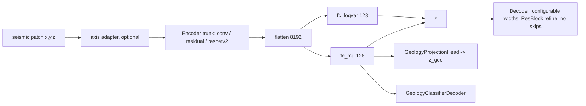

# Pretrain-v2 Encoder, Loss, Augmentation, and Real-Seismic Transfer — Implementation Plan

Date: 2026-09-27
Parent plans:
[2026-09-25__geology_classifier_decoder_and_class_anchored_sampling_plan.md](2026-09-25__geology_classifier_decoder_and_class_anchored_sampling_plan.md),
[2026-09-01_geo-aware_improvement_plan.md](../training/2026-09-01_geo-aware_improvement_plan.md) (parent-plan lever D2, bigger encoder)
Source repo: `/Users/donaldpg/synthoseis-pretrain-v2` (reconstruction-only 3D ResNetV2 U-Net)

Checkpoint-location update (2026-10-05): most archived checkpoint folders now live under
`/Volumes/CrucialX9/3dvae-poc_checkpoints`. References to confirmed moved folders in the
planning/session docs have been updated; P0a, both P0b controls, and P4 are still local.
Do not mechanically replace every `checkpoints/` path. Runtime scripts were not modified
by this documentation migration; preflight their inputs before rerunning old suites.

This plan is written so a Copilot agentic model can implement it autonomously, one work
package (WP) at a time, with a test gate and a benchmark gate after each. Decisions made with
the user on 2026-09-27 are recorded in Section 10.

---

## 1. Goal and how it maps to the parent plans

**Primary goal (unchanged):** better geology retrieval with cosine similarity of `z_geo` in the
`seismic_tokenizer`.

- **Primary metric:** `diagnostics.neighbor_overlap_at_5` (n@5), tie-broken by n@10, on a
  **new frozen 7-key manifest** built from new validation volumes that neither repo has trained
  on (WP0, decision D2): `docs/benchmarks/frozen_validation_manifest_v2.json`. The old manifest
  is kept for historical comparison only. A result must hold for **two seeds** before it is
  adopted.
- **Current adopted model:** `/Volumes/CrucialX9/3dvae-poc_checkpoints/geoaware_v3_phase2_20260831/vae_epoch20.pt`
  (old manifest: n@5 0.1385, n@10 0.2269). Best leak-free experimental: R2 seed 1 epoch 30
  (old manifest: n@5 0.1346). Both are re-benchmarked on the new manifest in WP1 and those
  values become the baselines.
- **Reconstruction guardrails:** synthetic `val_loss` within 2% of the baseline on the same
  validation set and loss configuration (as before), **plus a new real-seismic test MAE**
  (Section 7).
- **Target:** n@5 in the 0.18–0.25 band.

The 2026-09-25 plan concluded that the current architecture has plateaued at about 0.13–0.14 and
that a structural change is needed. Pretrain-v2 already searched encoder structure, loss mixes,
and augmentations for seismic reconstruction. This plan brings those results into this repo
**without** giving up the geology-aware parts (projection head `z_geo`, SupCon, classifier
decoder, class-anchored sampling, label-driven batch sampler).

| This plan | Parent-plan lever | Why it should help n@5 |
|---|---|---|
| Configurable, deeper, wider ResNetV2 encoder (optional pretrain-v2 weight transfer) | D2 bigger encoder | Current conv trunk has only 0.21 M parameters; nearly all 3.46 M parameters are in the flatten→FC layers. A stronger trunk gives `mu` richer structure for `z_geo`. |
| MAE-dominant multi-component reconstruction loss (+ small LPIPS / TV / GDL) | Reconstruction anchor quality | Best pretrain-v2 recipes; GDL keeps fault and reflector edges. |
| Seismic-physics augmentations (phase rotation, angle stacks, stretch, time-to-depth, noise) | A. more diverse data | Invariance to wavelet, angle, and velocity. Same-location views are natural SupCon positives. |
| Real seismic for reconstruction only | A. more diverse data | Moves the encoder toward field data; no geology labels are needed. |

Out of scope: U-Net skip connections into the reconstruction decoder (Section 3.3) and changing
the tokenizer latent contract (`latent_dim` 128, `mu`, `z_geo`). The geology decoders stay and
are extended (Section 3.5).

---

## 2. Evidence this plan is based on

### 2.1 Best pretrain-v2 runs (`/Volumes/CrucialX9/pretrain_v2_checkpoints/epoch_component_metrics3a.xlsx`)

The workbook contains 2,333 epoch rows from 60 run folders. Column **AY** is the rank of
summed per-component ranks on train/validation; **BA** is the corresponding real-seismic-test
rank (CostaRica, Poseidon parts 1/2, cn1); lower BA is better. BA is numeric on 1,425 rows.
Those rows collapse to 10 distinct architecture/loss recipes. I grouped on **E–H** (levels,
hidden dims, kernel schedule, encoder blocks) plus **K–P** (MSE, PMSE, MAE, LPIPS, TV, GDL),
then ranked each recipe by its minimum BA across epochs. **I** is the learning rate at that
epoch and **J** is derived parameter count; neither defines a distinct architecture/loss recipe.
This avoids counting repeat epochs of one recipe as separate candidates. The five best unique
recipes are:

| Candidate / workbook row | Best BA rank (epoch) | C run id | E levels | F hidden dims | G kernel schedule | H encoder blocks | I LR | J params (M) | K:P weights (MSE, PMSE, MAE, LPIPS, TV, GDL) | VAE source snapshot |
| --- | ---: | --- | ---: | --- | --- | --- | ---: | ---: | --- | ---: |
| r006 / 1275 | 1 (51) | `sweep_20260620_080306_r006_u3_h32-64-128_lp0p000_tv0p001` | 3 | 32 64 128 | 3 3 3 | deeper 3 5 8 | 1.4e-5 | 17.01 | 0, 0, 0.995, 0.005, 0, 0 | epoch 50 |
| r004 / 1330 | 3 (56) | `sweep_20260620_035309_r004_u3_h40-80-160_lp0p000_tv0p001` | 3 | 40 80 160 | 3 3 3 | deeper 3 5 8 | 1.4e-5 | 26.57 | 0, 0, 0.995, 0.005, 0.001, 0 | epoch 55 |
| r007 / 2251 | 3 (86) | `sweep_20260621_232252_r007_u4_h40-74-138-256_lp0p000_tv0p001` | 4 | 40 74 138 256 | 3 3 3 3 | deepest 3 5 8 5 | 1.4e-5 | 74.58 | 0, 0, 0.999, 0, 0, 0.001 | epoch 85 |
| r001 / 1260 | 5 (54) | `sweep_20260621_104613_r001_u4_h40-74-138-256_lp0p000_tv0p010` | 4 | 40 74 138 256 | 3 3 3 3 | deeper 3 4 8 4 | 2.6405e-5 | 72.09 | 0, 0, 0.995, 0.005, 0, 0 | epoch 50 |
| r011 / 2331 | 7 (96) | `sweep_20260622_085428_r011_u4_h32-64-128-256_lp0p000_tv0p010` | 4 | 32 64 128 256 | 3 3 3 3 | baseline 3 4 6 3 | 1.4e-5 | 58.92 | 0, 0, 0.99, 0, 0, 0.01 | epoch 95 |

The source snapshot is the nearest saved five-epoch checkpoint at or before the best-BA row;
the workbook's best-BA epoch itself is not necessarily checkpointed. Row 1275/1336 and other
repeat epochs are the same r006 architecture/loss recipe, not additional candidates. BA ranks
3 are tied; row order is only a stable display order, not a tie-break performance claim.

Findings:

1. MAE is 0.99–0.999; MSE/PMSE are zero. Helpers are LPIPS 0.005, TV 0.001, or GDL 0.001–0.01.
2. The distinct top five include three- and four-level models, three depth schedules, and widths
  from 32-64-128 through 40-74-138-256.
3. The upstream kernel schedule is 3 in every level for these five recipes, so kernel size is
  held fixed rather than treated as an extra search variable.
4. The best-BA LR values are 1.4e-5 to 2.64e-5 under upstream Adam/poly scheduling. POC VAE
  training uses its established AdamW schedule; column I is captured evidence, not copied as
  the new VAE decoder's LR.
5. Real-test MAE (~0.323–0.331 in the upstream comparison) remains a domain-shift guardrail.

### 2.2 The two repos side by side

**Network**

| Aspect | synthoseis-3dvae-poc (this repo) | synthoseis-pretrain-v2 |
|---|---|---|
| Task | VAE: masked input → flat latent (128) → clean reconstruction; `z_geo` for retrieval | U-Net: masked input → clean reconstruction; no latent bottleneck, no KL |
| Patch | 32×32×64, axes (x, y, z) | 128×128×128, axes (z, x, y) |
| Encoder trunk | 5 × `Conv3dBlock` (or `ResidualConv3dBlock`), widths 16-32-32-64-64, /8 | ResNet50V2: stem 7³ s2 + maxpool (/4), bottleneck stages (expansion 4), stride 2 from stage 2 |
| Norm / activation | BatchNorm3d / GELU | InstanceNorm3d (affine) / ReLU pre-activation; GELU in decoder |
| Depth | 1 block per layer | per-stage blocks: baseline 3 4 6 3, deeper 3 5 8 or 3 4 8 4, deepest 3 5 8 5 |
| Bottleneck | flatten 64×4×4×8 = 8,192 → `fc_mu`/`fc_logvar` (1.05 M params each) | none (skip connections) |
| Decoder | FC → 3 × (trilinear up + `Conv3dBlock`), optional deep supervision | trilinear up + conv + skip concat + `ResBlock3d` per level |
| Params | 3.46 M (trunk 0.21 M) | 17–75 M (encoder 5.6 M for r006) |
| Extra heads | `GeologyProjectionHead` (`z_geo`), `GeologyClassifierDecoder` | segmentation head swap (fine-tune) |

**Losses**

| Loss | 3dvae-poc | pretrain-v2 | Common? |
|---|---|---|---|
| MSE / PMSE | `mse_pmse` blend (`--loss_mse_weight`) | `--mc_mse_weight`, `--mc_pmse_weight` (0 in top runs) | yes (same PMSE definition) |
| MAE | `--reconstruction_loss mae` (weight 1) | `--mc_mae_weight` 0.99–0.999 | yes |
| LPIPS | `--lpips_weight` 0.1 (current recipe), alex, **2 vertical mid-planes** (inline, crossline) | 0.005, alex, **3 orthogonal mid-planes** (adds the time slice), plus optional amplitude-calibration term | yes, different planes and weight |
| TV | — | `--mc_tv_weight` (0.001) | pretrain-v2 only |
| GDL | — | `--mc_gdl_weight` (0.001–0.01), gradient-magnitude difference on 3 axes | pretrain-v2 only |
| Loss validity mask | — | geometric mask from stretch/squeeze edges | pretrain-v2 only |
| KL | warmup to 1e-3 | — | poc only |
| Deep supervision | optional | — | poc only |
| Geology SupCon, uniformity, metadata alignment, classifier BCE/focal + dip CE | yes | — | poc only |

**Augmentations**

| Augmentation | 3dvae-poc | pretrain-v2 | Label impact (for geology-aware training) |
|---|---|---|---|
| Flip x, flip y, swap x↔y (p 0.5 each) | yes | yes | presence and dip magnitude unchanged |
| Extrema-only / sparse keep / decimate+trilinear input (one of three) | yes | yes | input only |
| Trace-cluster dropout | yes (8–12 traces) | yes (ratio 0.07, cluster p 0.8) | input only |
| Extrema mixup from a second patch | yes (p 0.10) | — | input only |
| Piecewise vertical warp | yes (p 0.5, local step 0.5–2.0) | — | changes apparent dip; dip labels now adjusted (Section 5) |
| Constant phase rotation | — | triangular(−60°, 0°, 40°), every sample | none |
| Random angle stack (5°, 17°, 29°, fullstack) | — (fullstack only) | yes, random key per sample | none (same geology) |
| Anisotropic stretch/squeeze | — | x, y ∈ [0.8, 1.25], z ∈ [0.667, 1.5]; extract larger block for squeeze; validity mask | changes apparent dip and object size; presence can change at borders |
| Time-to-depth (depth-dependent z stretch) | — | p 0.6, velocity gradient 0.3–0.8 | changes apparent dip |
| Gaussian noise (2% of std) | — | present in code, not in the training path | none |
| Normalization | `--input_scaling divide_by_std` | divide by pre-augmentation std, no mean removal | same |

**Data and training**

| Aspect | 3dvae-poc | pretrain-v2 |
|---|---|---|
| Synthetic source | pre-sampled 32×32×64 zarr patches (25 GB per 108 k set) from the 180 training volumes (runs 1041–1220), excluding `fake_data/validation` | on-the-fly crops from full volumes (runs 1000–1239, 10 new volumes per pass) |
| Real seismic | none | train: `/Users/donaldpg/synthoseis/real_data` (Netherlands1–4 `.real.zarr`, key `volume`); test: `/Users/donaldpg/synthoseis/fake_data/test` (CostaRica_part1, Poseidon_part1/2, cn1). This plan adds Penobscot3D to training (D6). |
| Optimizer / LR | AdamW 5e-4, `--encoder_lr_mult` 0.1, plateau scheduler | Adam 1e-5 to 5e-5, poly decay with 5-epoch warmup, `lr_min` 5e-6 |
| Batch | 12 | 1–2 (128³) |
| Regularization | weight decay 1e-4, grad clip 2.0 | grad clip 1.0, EMA 0.999 |

### 2.3 Facts checked for this plan

- Pretrain-v2 checkpoint layout: keys `model`, `ema_state`, `optimizer`, `train_paths`,
  `val_paths`; the encoder is under the `encoder.*` prefix
  (`encoder.stem_conv`, `encoder.stages.{i}.blocks.{j}.*`). For r006 the encoder has 5.56 M
  parameters.
- With the pretrain-v2 3-level encoder (/16) a 32×32×64 patch becomes 2×2×4 with
  128 × 4 = 512 channels, so the flattened size is **8,192, the same as today**. `fc_mu` and
  `fc_logvar` keep their shape.
- Real volumes are `.real.zarr` with a single array `volume` (e.g. cn1 `(400, 701, 600)` float32)
  and attr `volume_std`.
- Synthetic volumes contain all four stacks: `seismicCubes_cumsum__5_degrees`,
  `__17_degrees`, `__29_degrees`, `seismicCubes_cumsum_fullstack`.
- **Overlap:** pretrain-v2 trained on runs 1000–1239 (loop state `start_index_next` 1240).
  This repo's validation volumes are runs 0570–0574, 1040, and 1221–1239, so 20 of the 25
  validation volumes were seen (seismic only, no labels) by the pretrain-v2 models. Decision D2:
  generate new validation volumes and re-freeze the manifest (WP0).
- The old manifest has 512 examples but only **52 eligible queries**, which is why n@5 is noisy.
  `scripts/evaluate_geology_benchmark.py` creates a manifest when the path does not exist
  (`--benchmark_size`, default 512, `--seed`).
- One synthetic volume folder is about 3.1–3.2 GB. `/Volumes/CrucialX9` has **964 GiB free**
  (49% used); the internal disk has 128 GiB free and `data/` already uses 86 GB.
- Penobscot3D (`/Volumes/CrucialX9/real_data/Penobscot3D/Penobscot3D.real.zarr`, key `volume`):
  shape (601, 481, 901), attr `axis_order` = inline, crossline, z (same (x, y, z) order as the
  synthetic data), `volume_std` 1816.7. Amplitudes span about −32,058 to 32,767, so the
  strongest peaks are clipped at the int16 limit; about 5.6% of samples in a probe block are 0.
  It is a different basin (Nova Scotia) from the Netherlands training volumes.
- In this repo `vertical_warp` changes apparent dip but `meta_dip_mean_class` and
  `meta_dip_range_class` were precomputed and not adjusted (fixed 2026-09-27, Section 5).
- **Why 5 old validation volumes have no labels:** synthoseis `main.py --zarr-out` controls which
  arrays are kept. `essential` keeps only the 4 seismic stacks and `geologic_score`;
  `segmentation` also keeps every label array this repo needs (`fault_segments_id`,
  `fault_intersection_segments`, `faults/faulted_channel_labels`, `closure_segments_id` and the
  closure masks, `onlap_segments`, `faulted_lithology`, `flat_spot`, `geologic_age_faulted`).
  `~/synthoseis-pre-train/generate_datasets.sh` (May 22) passes `--zarr-out essential`;
  `/Users/donaldpg/synthoseis-pretrain-v2/generate_datasets.sh` (Jul 22) passes
  `--zarr-out segmentation`. Runs 0570–0574 (May 31) were made with the old script, so their
  labels were deleted at generation time. `scripts/sample_patches.py` can only copy labels that
  exist in the source volume, so it skips those volumes (`skipped_volumes_missing_labels`).
  Note: `run_top10_retrain_loop.py` still defaults `--generate-script` to the old script.

---

## 3. Architecture



### 3.1 Configurable encoder (`src/model.py`)

New constructor flags, saved in the checkpoint config. Defaults reproduce today's model exactly.

| Flag | Default | Meaning |
|---|---|---|
| `--encoder_arch {conv,residual,resnetv2}` | `conv` (`residual` when `--residual_encoder` is set) | trunk type |
| `--encoder_hidden_dims` | none → `base_ch` rule | per-stage widths, e.g. `32 64 128` |
| `--encoder_depth_profile {baseline,deeper,deepest}` | `baseline` | same tables as pretrain-v2 |
| `--encoder_stage_blocks` | none | explicit override, e.g. `3 5 8` |
| `--encoder_norm {batch,instance,group}` | `batch` for conv/residual, `instance` for resnetv2 | normalization |
| `--encoder_stem {pretrain_v2,light}` | `pretrain_v2` | 7³ s2 + maxpool (/4), or 3³ s2 with no maxpool (/2, keeps more resolution for the small patch) |
| `--decoder_hidden_dims` | none → `base_ch` rule | decoder widths, deepest first |
| `--decoder_block {conv,res}` | `conv` | `ResBlock3d` refinement as in pretrain-v2 |

`resnetv2` reuses the pretrain-v2 classes (`BottleneckV2_3d`, `ResNetV2Stage3d`,
`ResNet50V2Encoder3d`), copied into `src/encoders_resnetv2.py` with a provenance comment so this
repo does not import the other repo. The encoder computes `flat_dim` from a dry forward pass
instead of the `/8` formula, so any stem and stage combination works as long as every patch axis
is divisible by the total stride.

Candidate encoders (all keep `latent_dim` 128):

| ID | Arch | Stem | Widths | Blocks | Feature map at 32×32×64 | Flat dim | Notes |
|---|---|---|---|---|---|---:|---|
| E0 | conv | — | 16-32-32-64-64 | 1 each | 64×4×4×8 | 8,192 | current |
| E1 | residual | — | 16-32-32-64-64 | 1 each | 64×4×4×8 | 8,192 | exists, not tested with geology losses |
| E2 | resnetv2 | pretrain_v2 | 32 64 128 | deeper 3 5 8 | 512×2×2×4 | 8,192 | r006 layout; **weight transfer possible** |
| E3 | resnetv2 | light | 32 64 128 | deeper 3 5 8 | 512×4×4×8 | 65,536 | more spatial detail; 8.39 M weights in each latent projection; stem not transferable |
| E4 | resnetv2 | pretrain_v2 | 40 80 160 | deeper 3 5 8 | 640×2×2×4 | 10,240 | r004 layout, transfer possible |

4-level pretrain-v2 encoders reduce 32×32×64 to 1×1×2, which is too small; they are not used
because the patch size stays 32×32×64 (D3).

**Normalization note:** InstanceNorm at the last stage of E2 normalizes over only 16 voxels.
Add a unit test that the outputs are finite and non-constant for low-variance patches, and keep
`--encoder_norm group` as a fallback.

### 3.2 Pretrained encoder transfer (`--init_encoder_from`)

- Load `ema_state` if present, else `model`, from a pretrain-v2 checkpoint; copy only
  `encoder.*` keys into `encoder.trunk.*`. Fail with a clear message if any shape differs.
- **Axis adapter:** this repo feeds (B, 1, x, y, z); pretrain-v2 expects (B, 1, z, x, y). Add
  `--encoder_input_axes {xyz,zxy}`. `zxy` permutes the input inside the encoder
  (`x.permute(0, 1, 4, 2, 3)`), so no weight permutation is needed and the latent contract is
  unchanged.
- `fc_mu`, `fc_logvar`, decoder, heads are newly initialized.
- Schedule: `--freeze_encoder_epochs N` (default 0). Freeze the trunk for N epochs so the new FC
  and decoder settle, then unfreeze with `--encoder_lr_mult 0.1`.
- Record `init_encoder_from`, its epoch, and its `train_paths` count in the checkpoint config.

### 3.3 Why U-Net skip connections are not adopted

Skip connections let the decoder rebuild the patch from encoder feature maps and bypass the
latent. That lowers reconstruction loss but empties `mu`, which is what `z_geo` and the
classifier read. The decoder stays skip-free. Only the pretrain-v2 **decoder refinement block**
(`ResBlock3d`) is borrowed.

### 3.4 Compatibility

- `scripts/train.py` resume / warm-start allowlist: a checkpoint with a different
  `encoder_arch` cannot be resumed into another arch; fail clearly. Same-arch resume must be
  exact.
- `src/tokenizer/core/model_adapter.py` must build `VAE3D` from the new config keys when they are
  present and fall back to `base_ch` for old checkpoints. Required keys stay
  `model_state_dict, patch_shape, latent_dim, base_ch`.

### 3.5 Geology decoders (kept and extended)

The model keeps decoders for more than reconstruction:

- **Patch classifier decoder** (`GeologyClassifierDecoder` on `mu`: 7 presence logits + dip-mean
  and dip-range classes) is on in **every** geology run and works with every encoder E0–E4 (it
  only needs `mu`, which is 128-d for all of them).
- **Also in reconstruction stage 1** of P5–P8, at `--geology_classifier_weight 0.05`, so `mu`
  is shaped by geology while the new trunk is trained, not only in stage 2. Real samples are
  masked out of it (Section 6.2). P5 is run with and without this term (P5a / P5b).
- **Voxel geology decoder** (parent-plan WP6 design, moved into this plan as WP8 / run P9): a
  skip-free decoder from `mu` with 7 output channels at full patch resolution, focal (γ = 2) +
  soft Dice per class, water masked from the sand loss. It reads `mu`, not encoder feature maps,
  for the same reason as Section 3.3: skips would let it bypass the latent used for retrieval.
  It needs `sample_patches.py --store_label_patches` (uint8, ~1.75× the patch storage, ~44 GB
  for a 108 k set) written to `/Volumes/CrucialX9`, because the internal disk has 128 GiB free.
- All decoder heads are separate modules; the tokenizer adapter keeps ignoring
  `geology_classifier.*` and the new `geology_voxel_decoder.*` keys.

---

## 4. Loss (`scripts/train.py`)

### 4.1 Multi-component reconstruction

New choice `--reconstruction_loss multi_component` (existing `mse_pmse` and `mae` keep working):

```
recon = w_mse·MSE + w_pmse·PMSE + w_mae·MAE + w_tv·TV(pred) + w_gdl·GDL(pred, target)
total = recon + lpips_weight·LPIPS + kl·KL
      + geology_contrastive_weight·SupCon(z_geo) + geology_classifier_weight·L_cls   (unchanged)
```

| Flag | Default | Notes |
|---|---|---|
| `--recon_mse_weight`, `--recon_pmse_weight`, `--recon_mae_weight` | 0, 0, 1 | same definitions as pretrain-v2 `losses.py` |
| `--recon_tv_weight` | 0 | mean absolute finite difference on 3 axes, averaged |
| `--recon_gdl_weight` | 0 | mean over 3 axes of `| |∇pred| − |∇target| |` |
| `--lpips_planes {vertical,orthogonal}` | `vertical` | `orthogonal` adds the mid time slice (pretrain-v2 behavior) |
| `--recon_valid_mask` | on when geometric augmentation creates edges | loss only over valid voxels |

Deep supervision applies the same `recon` to each auxiliary output. Log each component
separately (`train_mae`, `train_mse`, `train_pmse`, `train_lpips`, `train_gdl`, `train_tv`, and
`val_*`, `real_val_*`, `real_test_*`) so runs can be ranked like the spreadsheet.

### 4.2 Recipes to test

| ID | MAE | LPIPS | TV | GDL | Source |
|---|---:|---:|---:|---:|---|
| L0 | 1.0 | 0.1 | 0 | 0 | current poc recipe |
| L1 | 0.995 | 0.005 | 0 | 0 | r006 / r001 |
| L2 | 0.995 | 0.005 | 0.001 | 0 | r004 / copilot_2 |
| L3 | 0.99 | 0 | 0 | 0.01 | r011 |
| L4 | 0.99 | 0.005 | 0 | 0.005 | combination (new) |

LPIPS on 32×32 vertical slices is upsampled to 64 (`--lpips_min_size`); on a 32×32 time slice it
is also upsampled. The v1b history showed LPIPS 0.1 kept improving slowly, so L0 stays as the
control rather than being dropped.

**Implementation status (2026-09-30):** only `--recon_mae_weight`, `--recon_tv_weight`, and
`--recon_gdl_weight` exist in `scripts/train.py` (added to run P1). `--recon_mse_weight`,
`--recon_pmse_weight`, `--lpips_planes`, and `--recon_valid_mask` are not implemented; P1 ran
with LPIPS on the existing vertical planes only and no valid-voxel masking. Per-component loss
logging (`train_mae`, `train_tv`, `train_gdl`, etc.) also does not exist; only the combined
`loss` value is logged. This was sufficient for P1 (no geometric augmentation was active, so
there were no invalid edge voxels to mask), but WP2 is not fully built. P5/P6 use the unchanged
P0b MAE + vertical LPIPS recipe with phase rotation and stretch disabled, so they do not require
orthogonal LPIPS or the geometric valid-voxel mask. Those WP2 features remain prerequisites for
any later run that explicitly enables them.

---

## 5. Augmentation (`src/augmentations.py`, `scripts/sample_patches.py`, `scripts/train.py`)

All new augmentations default to off. Geology labels are precomputed per patch, so each
augmentation declares its label rule.

| Aug | Flags (default) | Where | Label rule |
|---|---|---|---|
| Phase rotation | `--phase_rotation_prob 0`, `--phase_range -60 0 40` | train-time, on the clean patch before input masking (x and y both) | invariant |
| Angle stack | `sample_patches.py --stack_keys` (default and **current use: fullstack only**, D5), `--stack_mode {single,random_per_patch,all}` | sampling time | invariant; with `all`, same-origin stacks are extra SupCon positives |
| Gaussian noise | `--noise_prob 0`, `--noise_std_frac 0.02` | train-time, input only | invariant |
| Lateral/vertical stretch (zoom-in only, D4) | `--stretch_prob 0`, `--stretch_xy 1.0 1.25`, `--stretch_z 1.0 1.5` | train-time, zoom then center crop | dip classes per the dip rule; presence kept (small risk at borders) |
| Time-to-depth | `--t2d_prob 0`, `--t2d_velocity_gradient 0.3 0.8` | train-time | dip rule (below), with the t2d depth stretch |
| Existing vertical warp | unchanged flag | train-time | dip rule (below); **implemented 2026-09-27** |

**Dip and azimuth label rule (implemented 2026-09-27)** — `--dip_label_policy {adjust,mask,ignore}`,
default `adjust`; code in `src/geology_label_augment.py`, wired into `ZarrPatchDataset`:

- `adjust`: `sample_patches.py` now stores `dip_samples_deg` / `dip_samples_z` (512 random voxel
  dips and their z per patch, `--dip_sample_count`). A depth mapping with `s` output samples per
  source sample gives `tan(dip') = tan(dip) · s` and `s`× more voxels at that depth, so the
  samples are stretched and density-weighted; the change in mean / std / p90−p10 is added to the
  exact stored values and both dip classes (and `meta_structural_complexity`) are re-binned with
  the edges in the dataset attrs. Any depth mapping (vertical warp now; stretch and t2d later)
  only needs its per-depth `s`. Old datasets: `scripts/add_dip_samples.py --data <zarr>` fills
  the arrays from the source volumes (about 28 min per 108 k set) and checks the stored dips.
  Training fails with a clear message if `adjust` is needed and the arrays are missing.
- `mask`: dip-class targets become −1 for warped samples; the classifier loss skips them.
- `ignore`: previous behavior.
- Azimuth (`meta_azimuth_mean_deg`, when loaded) always follows x/y swaps and flips
  (swap: 90° − a; flip x: 180° − a; flip y: −a). Dip and circular variance do not change under
  flips or swaps.
- On `data/synth_val_uniform_32-32-64.zarr` the default vertical warp changed the dip-range class
  for 22% of warped patches and the dip-mean class for 2% (median |Δ dip range| 0.6°, p95 4.4°).

**SupCon metadata:** the 7 contrastive keys are fractions (fault, channel, flat spot, onlap,
intersection). They do not change under phase, stack, noise, flips, or small stretches, so strata
stay valid.

**Phase implementation status (2026-09-30):** the phase-rotation portion of WP3 is implemented
in `src/augmentations.py` and wired through `scripts/train.py`. It applies one triangularly sampled
angle per patch to both clean target and paired input before input-only masking. P2 uses
`--phase_rotation_prob 1.0 --phase_range -60 0 40`; the remaining WP3 augmentations and
stack-ready sampling are still pending and are not part of P2.

**Zoom-in stretch implementation status (2026-09-30):** paired trilinear zoom plus center crop
is implemented with `--stretch_prob`, `--stretch_xy`, and `--stretch_z`. XY uses one shared scale
so apparent dip follows the exact factor `s_z / s_xy`; sampled dip labels are adjusted under
`dip_label_policy=adjust`, including composition with the existing vertical warp. Scales below
1 are rejected, so no padding is possible. A real training-Zarr smoke test and the full 222-test
suite pass. P3 starts with seed `20260925`; seed `20260926` is gated on beating P0b n@5 0.0120.

**Context for squeeze (D4: zoom-in only):** pre-sampled patches have no margin, so only `s ≥ 1`
(zoom in and center crop) is implemented. No new data is needed. A `--context_margin` option
(48×48×96 stored patches, ~85 GB per 108 k set) is not part of this plan.

**Angle-stack expansion (D5):** runs in this plan use fullstack only, but the data format and
code must accept the 5°, 17°, and 29° stacks later without a format change:

- `sample_patches.py --stack_keys KEY [KEY ...]` (default `seismicCubes_cumsum_fullstack`). Attrs
  record `stack_keys` in order.
- `--stack_mode single` (default; one key), `random_per_patch` (one random key per origin, same
  storage), or `all` (every key at every origin; `patches` rows are grouped by origin).
- Per-patch arrays `stack_index` (int8, index into `stack_keys`) and `origin_id` (int64; equal for
  patches cut at the same location). With `single`, `stack_index` is all 0 and `origin_id` is the
  row number. Metadata and label arrays are computed once per origin and copied to each stack row.
- Training reads these arrays when present and defaults them when absent (old datasets).
- `origin_id` lets SupCon treat same-origin stacks as positives (`--supcon_same_origin_positive`,
  off by default) and lets the train/val split keep all stacks of one origin together.
- Model input stays 1 channel; stacks are separate samples, not channels.

---

## 6. Real seismic for reconstruction only

### 6.1 Sampling (`scripts/sample_patches.py --source_format real`)

- Read `.real.zarr` (array key `volume`) and `.npy` volumes. Confirm the axis order on each
  volume before sampling (expected (x, y, z) like the synthetic zarr); add `--real_axes` to
  override.
- Uniform patch origins, a minimum-std filter to skip dead/padded zones (`--min_patch_std`),
  `divide_by_std` scaling identical to synthetic.
- Write the same `patches` array plus `is_real=1`, `source_volume`, and no `meta_*` or
  `label_presence_*` arrays. Attrs record the source paths and split.
- Splits (D6): current pretrain-v2 split plus Penobscot3D **in training**.
  - Train: Netherlands1–4 (`/Users/donaldpg/synthoseis/real_data/*.real.zarr`) and Penobscot3D.
  - Validation: spatial hold-out blocks from each training volume (last 15% of inlines per
    volume, with a 32-sample buffer gap so no training patch overlaps a validation patch).
  - Test: `/Users/donaldpg/synthoseis/fake_data/test` (CostaRica_part1, Poseidon_part1/2, cn1),
    unchanged, so results stay comparable to pretrain-v2 column BA.
  - Why Penobscot goes to training: all current real training data come from one basin
    (Netherlands, about 620 M samples). Penobscot adds about 260 M samples (+42%) from a second
    basin, which targets the real-data domain gap in Section 2.1. The test set already covers
    three other regions and real-test MAE is only a guardrail (D7), so a separate out-of-basin
    validation volume adds less than the extra training diversity.
  - Penobscot handling: skip patches with more than 5% zeros or with clipped samples
    (|value| ≥ 32,000) above 1%; normalize per patch with `divide_by_std` like every other
    source.
- Balance: sample patches per volume in proportion to the square root of its sample count, so
  the largest volume does not dominate.

### 6.2 Training (`scripts/train.py`)

| Flag | Default | Meaning |
|---|---|---|
| `--real_data PATH` | none | real patch zarr (train) |
| `--real_validation_data PATH` | none | real val |
| `--real_test_data PATH` | none | real test, evaluated each epoch, never used for selection |
| `--real_batch_count K` | 0 | K real samples appended to each batch (e.g. 2 of 14) |
| `--real_recon_weight` | 1.0 | weight on the real part of the reconstruction loss |

- A per-sample `is_real` mask removes real samples from SupCon, uniformity, metadata alignment,
  classifier loss, geology strata, and hard-example mining. KL and reconstruction apply to all.
- The geology batch sampler builds the synthetic part exactly as now; the real part is drawn
  uniformly. The synthetic batch size stays 12 so the Phase 2 sampler settings stay valid.
- Augmentations on real patches: flips, swap, phase, noise, input masking. No label rule needed.
- Checkpoint selection stays on synthetic `val_loss` + n@5; `real_test_mae` is a guardrail.

---

## 7. Metrics and acceptance gates

| Metric | Role | Gate |
|---|---|---|
| n@5 (then n@10), **v2 frozen manifest**, `z_geo` | primary | > current best in **2 of 2 seeds** |
| synthetic `val_loss` (v2 validation set, same loss config) | guardrail | not worse than +2% |
| `real_test_mae` (new, 4 test volumes) | guardrail (D7) | not worse than the arm's control by more than 2%; report the delta |
| classifier macro AUROC (natural prevalence) | sanity | ≥ 0.75 target (not yet met; report) |
| component metrics (MAE, MSE, PMSE, LPIPS, GDL) on train / val / real test | diagnostics | spreadsheet-style rank-sum across runs |

Loss mixes change the value of `val_loss`, so compare recipes on **val MAE** (a fixed metric),
not on `val_loss`.

---

## 8. Work packages

Each WP ends with new/updated stdlib `unittest` tests passing, the full suite passing
(`.venv/bin/python -m unittest discover -s tests`), and, where training is involved, a benchmark
on the frozen manifest.

### WP0 — New leak-free validation volumes and v2 manifest (D2)

- Generate **25 new labeled synthoseis volumes** with run indices **5000–5024**. These satisfy
  “≥ 1240” and stay far from the pretrain-v2 retrain loop, whose next start index is 1240, so a
  future loop pass cannot train on them. Record this range in the session summary and never use
  5000+ as a pretrain-v2 start index.

  ```bash
  /Users/donaldpg/synthoseis-pretrain-v2/generate_datasets.sh -n 25 \
    --synthoseis-dir ~/synthoseis/synthoseis \
    -d /Volumes/CrucialX9/fake_data_validation_v2 \
    --start-index 5000
  ```

  Use this script (it passes `--zarr-out segmentation`), **not**
  `~/synthoseis-pre-train/generate_datasets.sh` (`--zarr-out essential` deletes the labels).
  Before the full batch, generate one volume and confirm it has every array in
  `LABEL_CLASS_SOURCES` plus `geologic_age_faulted`.

  Output goes to a folder **outside** `fake_data`, so `sample_patches.py`'s `rglob` over the
  training source cannot pick it up. About 80 GB (25 × ~3.2 GB); 964 GiB free.
- Check that every new volume has the label arrays (5 of the old 25 did not); regenerate any
  that do not. Check `label_z_offset` = 1 with `scripts/verify_label_alignment.py` on 5 volumes.
- Sample two validation patch sets from the new volumes:
  - `data/synth_val_v2_32-32-64.zarr`: same sampling settings as
    `data/synth_val_32-32-64.zarr` (copy them from its attrs) for the retrieval benchmark.
  - `data/synth_val_v2_uniform_32-32-64.zarr`: uniform, natural prevalence, 200 per volume, for
    `val_loss` and classifier metrics.
- Freeze `docs/benchmarks/frozen_validation_manifest_v2.json` with
  `scripts/evaluate_geology_benchmark.py --manifest <v2 path> --benchmark_size 2048 --seed 20260927`.
  2048 examples should give about 4× the 52 eligible queries of the old manifest, which narrows
  the n@5 interval. Report the eligible-query count.
- Keep the old manifest and old validation patch sets untouched for historical comparison.
  The old validation volumes are **not** training data for this plan.
- **Training data:** the 180 labeled synthoseis datasets in `/Volumes/CrucialX9/fake_data`,
  excluding the nested `validation` folder. This is the existing
  `data/synth_train_anchored_32-32-64.zarr` set: 108,000 patches at 600 per volume, with
  metadata, one-hot `label_presence_*` targets, and dip samples.
- **Validation data:** the 25 new datasets in `/Volumes/CrucialX9/fake_data_validation_v2`,
  sampled into `data/synth_val_v2_32-32-64.zarr` and
  `data/synth_val_v2_uniform_32-32-64.zarr`. They are never added to training.
- The five old unlabeled datasets under `fake_data/validation` remain ignored. The old
  validation folder is not used for the new training/validation split.
- **Reconstruction test data:** use only real seismic patches sampled from
  `/Users/donaldpg/synthoseis/fake_data/test` (CostaRica, Poseidon, cn1), not the synthetic
  validation datasets. Real seismic contributes reconstruction metrics only; it has no geology
  classifier labels.
- The canonical synthetic training patch set is `data/synth_train_anchored_32-32-64.zarr`.
- Tests: training-source listing never includes `fake_data_validation_v2`; manifest creation is
  deterministic for a seed; the benchmark refuses a manifest whose `dataset_size` does not match
  the data.

### WP1 — Metrics parity and real-test evaluation (no training)

- Add per-component metric logging (Section 4.1) with loss weights at 0 by default.
- Add `scripts/evaluate_real_reconstruction.py`: loads a checkpoint, runs a real patch zarr,
  writes MAE/MSE/PMSE/LPIPS/GDL JSON.
- Real sampling (Section 6.1): real train (Netherlands1–4 + Penobscot3D), real val (spatial
  hold-out), real test (4 volumes).
- Re-benchmark the adopted checkpoint and R2 seed 1 ep 30 on the **v2 manifest**: n@5, n@10,
  val MAE, real test MAE. These are the P0 reference numbers.
- Tests: GDL is 0 for identical tensors and positive for a shifted edge; TV of a constant is 0;
  component logging does not change `total` when weights are 0 (regression); real sampler writes
  no label arrays, skips low-std / high-zero / clipped patches, and the spatial hold-out has no
  overlap with training origins.

### WP2 — Multi-component reconstruction loss

- Section 4.1: flags, masked loss, orthogonal LPIPS planes.
- Tests: `multi_component` with `mae=1` equals `--reconstruction_loss mae` exactly; weights sum
  as expected; the valid mask excludes voxels; `orthogonal` produces 3 planes with the right
  shapes for 32×32×64.

### WP3 — Augmentations with label rules, stack-ready sampling

- Section 5: phase rotation (vectorized rFFT along z), noise, zoom-in stretch, t2d, dip label
  policy, and the stack-ready data format (`stack_keys`, `stack_mode`, `stack_index`,
  `origin_id`) with fullstack as the only key used now.
- Tests: phase 0° is the identity and 180° equals negation; phase keeps the amplitude spectrum;
  stretch with s = 1 is the identity; zoom-in never pads; `mask` policy zeroes dip CE only for
  warped samples; `adjust` maps a 45° dip with s_z/s_xy = 2 to atan(2) = 63.4°.
- Stack-expansion tests on a small synthetic fixture with 4 stack arrays: `--stack_mode all`
  with 3 angle keys writes 3 rows per origin with equal `origin_id`, equal metadata and labels,
  and different patches; `random_per_patch` records the chosen `stack_index`; `single` output is
  identical to today's output for a fixed seed; an old dataset without `stack_index` /
  `origin_id` trains.
- Defaults leave training bit-identical for a fixed seed.

### WP4 — Real seismic in training

- Section 6.2.
- Tests: `is_real` samples contribute 0 to every geology loss and are never in strata; batch
  composition is 12 synthetic + K real; real-only metrics are logged; K = 0 is bit-identical to
  today.

### WP5 — Configurable encoder and decoder

- Section 3.1 and 3.4.
- Tests: E0 defaults produce a state dict identical to the current model (key names and shapes);
  E1–E4 forward on 32×32×64 with finite outputs and `mu` shape (B, 128); `flat_dim` from the dry
  run matches the table; InstanceNorm output finite for a low-variance patch; checkpoint round
  trip; tokenizer adapter loads each variant and returns the same `z_geo` as the training model;
  parameter count logged.

**Implementation status (2026-10-01):** `VAE3D` supports conv, residual, and ResNetV2 trunks,
configurable widths/depth/norm/stem/input axes, and a skip-free configurable decoder with conv or
ResNetV2 residual refinement blocks. Old E0 defaults retain their state-dict layout. The tokenizer
adapter reconstructs architecture-configured checkpoints. E1–E4 shape/latent/finite-forward tests,
low-variance normalization, and adapter parity tests pass.

### WP6 — Pretrained encoder transfer

- Section 3.2.
- Tests: all `encoder.*` tensors from a synthetic pretrain-v2-style state dict are copied
  exactly; a shape mismatch raises; `zxy` input axes give the same output as manually permuting
  the input; frozen epochs leave trunk weights unchanged and the optimizer skips them.

**Implementation status (2026-10-01):** `--init_encoder_from` prefers `ema_state.shadow`, copies
only `encoder.*` into `encoder.trunk.*`, and rejects missing, extra, or shape-mismatched tensors.
The real r006 checkpoint loaded all 150 encoder tensors (epoch 84; 10 `train_paths`). `zxy`
permutation, scheduled freezing/unfreezing, checkpoint provenance, and architecture-aware resume
checks are implemented. A two-epoch MPS smoke run loaded r006, trained with `K=0`, froze for one
epoch, unfroze, and completed; a second-stage resume also passed.

P5/P6 runners are `scripts/p5_encoder_transfer_suite.sh` (P5a/P5b) and
`scripts/p6_encoder_scratch_suite.sh`. They use the P0b recipe, disable phase rotation and
stretch, omit real training data (`K=0`), and use real validation/test stores only for MAE
guardrails. `PRINT_COMMANDS=1` renders commands without starting training.

### WP7 — Suite script and docs

- `scripts/pretrain_v2_transfer_suite.sh` with `set -euo pipefail`, one stage per run in
  Section 9, fail fast on missing inputs.
- Update `docs/training/README.md` with the new flags.
- Session summary `docs/sessions/2026-09-27-...md` (date-first).
- Do not commit benchmark manifests or milestone benchmark reports unless explicitly requested.

### WP8 — Voxel geology decoder (after P5–P8)

- Section 3.5; `--geology_classifier_mode {patch,voxel,both}` (the flag already exists and
  currently accepts only `patch`), `--geology_voxel_weight`, `--store_label_patches` output on
  `/Volumes/CrucialX9`.
- Tests: output shape (B, 7, 32, 32, 64); Dice loss is 0 for a perfect prediction; water voxels
  add nothing to the sand loss; real samples add nothing; tokenizer adapter ignores
  `geology_voxel_decoder.*` and returns the same `z_geo`.

---

## 9. Experiment sequence

One primary variable per run; two seeds for any candidate for adoption. "Warm-start" means the
Phase 2 recipe from the adopted checkpoint (decoder trainable, `--encoder_lr_mult 0.1`,
SupCon 0.5 / T 0.2, sampler background 0.05 / hard 0.30, uniformity 0), 20–40 epochs,
class-anchored train data (`data/synth_train_anchored_32-32-64.zarr`, 180 training volumes),
classifier weight 0.1 (R2 settings), `--dip_label_policy adjust`, validation on the v2
sets, unless stated.

| Run | Arm | Change vs control | Needs | Adopt / continue if |
|---|---|---|---|---|
| P0 | ref | Re-benchmark adopted + R2 seed 1 on the v2 manifest with new metrics | WP0, WP1 | sets the v2 baselines |
| P0a | ref | R2 recipe on the **old** 180-volume set (`synth_train_anchored_32-32-64`, dip samples backfilled) with `adjust` | WP0, WP1 | isolates the dip-label fix |
| P0b | ref | R2 recipe on the existing 180-volume training set, with the new v2 validation set, 2 seeds | WP0, WP1 | **control for P1–P4**; establishes the clean v2 holdout baseline |
| P1 | loss | Warm-start from P0b's recipe with L1, L2, L3, L4 (one each) | WP2 | n@5 ≥ P0b and val MAE / real MAE not worse; pick best recipe |
| P2 | aug | P0b unchanged + phase rotation (p 1.0, triangular −60°/0°/40°) | WP3 | n@5 up; else drop |
| P3 | aug | P0b unchanged + zoom-in stretch; keep dip policy `adjust`, omit rejected phase rotation | WP3 | n@5 up in two seeds; else drop |
| P4 | real | Best accepted current-architecture recipe (P0b unless P3 wins) + real recon (K = 2) | WP4 | real MAE down with n@5 not worse |
| P5 | arch | **E2 transfer**: two stages — P0b reconstruction recipe on synthetic data (60–150 epochs, trunk frozen first 5), then Phase 2 + classifier (40 epochs); phase/stretch off, no real mixing. P5a: stage 1 classifier weight 0.05; P5b: stage 1 weight 0 | WP5, WP6 | n@5 > best so far in 2 seeds |
| P6 | arch | E2 from scratch, same P0b two-stage recipe as P5a; phase/stretch off, no real mixing (control for transfer, D1) | WP5 | explains transfer gain |
| P7 | arch | E1 residual and E3 light stem, best of the P5/P6 pipeline | WP5 | n@5 > best so far |
| P8 | arch | E4 wider (40-80-160) transfer | WP5, WP6 | only if P5 wins |
| P9 | decoder | Best so far + voxel geology decoder (Section 3.5) | WP8 | n@5 > best so far in 2 seeds; voxel mean Dice reported |
| later | aug | 3 angle stacks (5°, 17°, 29°) with `--stack_mode all` + same-origin SupCon positives | WP3 format | separate follow-up (D5) |

**P0b status (2026-09-29):** completed with the 180-volume training set and the v2 validation
manifest. Seed `20260925` reached its best n@5 of **0.0120** at epoch 30 (n@10 0.0221,
best synthetic val loss 0.218987); seed `20260926` reached **0.0109** at epoch 30 (n@10
0.0167; its best synthetic val loss was 0.218169 at epoch 40). The adopted checkpoint's v2 reference is n@5
0.0102 / n@10 0.0178, and the P0a R2 seed-1 epoch-30 reference is n@5 0.0091 / n@10
0.0207. P0b therefore establishes the v2 baseline and is not a robust retrieval improvement
over the adopted model. Classifier macro AUROC was 0.639 and 0.635, below the 0.75 sanity
target. Proceed to P1's one-variable loss recipes, retaining the P0b checkpoints as controls;
do not start P2 augmentation or architecture work until a P1 recipe clears the n@5 and
reconstruction/real-seismic guardrails.

**P1 status (2026-09-30):** the first one-seed L1–L4 sweep completed. L1, L2, and L4 were
effectively tied: best n@5 **0.0099** at epoch 40 (n@10 0.0194). L3 peaked at n@5 **0.0109**
at epoch 20 (n@10 0.0177), but fell to 0.0078 by epoch 40. None exceeded both P0b seeds
(0.0120 and 0.0107), and classifier macro AUROC remained 0.632–0.649, below the 0.75 target.
The L3 replication at seed `20260926` completed with best n@5 **0.0096** at epoch 30
(n@10 0.0190; macro AUROC 0.657), so it did not reproduce the provisional gain. The loss
terms are therefore rejected as an adopted improvement. Retain P0b; do not start P2 augmentation
or architecture work from this P1 evidence. Any future change requires a new hypothesis and
fresh control rather than selecting an unsupported P1 recipe.

**P2 status (2026-09-30): rejected.** The phase-rotation portion of WP3 was implemented and
validated (218 tests passing), then P2 warm-started each seed from its matching P0b best
checkpoint using the actual P0b reconstruction recipe (`mae` plus LPIPS 0.1). Phase rotation
was the only recipe change: `--phase_rotation_prob 1.0 --phase_range -60 0 40`. Seed
`20260925` peaked at n@5 **0.0091** at epoch 40 (n@10 0.0163; macro AUROC 0.636), below its
P0b peak of 0.0120. Seed `20260926` peaked at n@5 **0.0122** at epoch 20 (n@10 0.0173;
macro AUROC 0.652), above its P0b peak of 0.0109. The best-per-run two-seed mean was 0.01065,
below P0b's 0.01145, and the gain did not reproduce across seeds. Do not adopt phase rotation
or carry it into P3/P4/P5–P8. Retain P0b as the control; no later experiment has been started.

**P3 status (2026-09-30): rejected.** Zoom-in stretch was implemented with paired trilinear
zoom/center crop, scales `s_xy ~ U(1, 1.25)` and `s_z ~ U(1, 1.5)`, phase rotation off, and
`dip_label_policy=adjust`. The real-data smoke check and all 222 tests passed. Seed `20260925`
peaked at n@5 **0.0130** at epoch 30 (n@10 0.0207; macro AUROC 0.628), clearing its P0b
0.0120 gate and triggering replication. Seed `20260926` peaked at only **0.0086** at epoch 10
(n@10 0.0169; macro AUROC 0.629), below its P0b 0.0109. The best-per-run mean was 0.01081
versus P0b 0.01146; the gain did not reproduce. Do not adopt or carry zoom-in stretch forward.

**P4 status (2026-10-01): rejected after seed 1.** WP4 now supports axis-aware real sampling,
square-root source allocation, quality rejection, per-patch standard-deviation scaling, and
buffered inline train/validation splits. Training appends `K` uniformly sampled real examples
to the unchanged synthetic batch and excludes their latent vectors from all geology and GAN
losses. The full suite passes (226 tests). P4 seed `20260925`, with `K=2`, phase rotation off,
and stretch off, peaked at n@5 **0.01094** and n@10 **0.01979** at epoch 20, below its P0b
control (n@5 0.01198, n@10 0.02214 at epoch 30). Real validation MAE moved from 0.71325 at
epoch 1 to a best of 0.70821; real test MAE moved from 0.67762 to a best of 0.67208. The real
reconstruction gain does not clear the primary geology-retrieval gate, so do not replicate P4
or carry real mixing into P5. Retain unchanged P0b as the current-architecture recipe.

**P5/P6 status (2026-10-03): completed, seed 20260925 only; not adopted.** All three arms
completed 60 reconstruction epochs, 40 geology epochs, and four frozen-manifest reports.
P5a best n@5 was 0.011719 at epoch 40 (n@10 0.019661; classifier AUROC 0.7755).
P5b best n@5 was 0.011198 at epoch 40 (n@10 0.020573; AUROC 0.7675).
P6 best n@5 was 0.010938 at epoch 30 (n@10 0.023177; AUROC 0.7677).
None beats P0b seed 20260925 n@5 0.011979. Best synthetic val losses were
0.356375/0.356796/0.354272, versus P0b 0.218987 (62-63% worse); best real-test MAEs
were 0.717662/0.710287/0.717474. These minima are not necessarily from retrieval-selected
epochs. A matching P0b real-test baseline still needs evaluation. Classifier improvement
does not qualify an arm for adoption. Retain P0b; pause replication and P8.

**Next step (2026-10-05):** P7's first-seed reconstruction comparison completed and
stopped at its gate: both clean modes fail; E1 passes extrema but E0 fails it. No P7 geology
stage, retrieval result, or replication exists. Before another training run, implement the
no-training tokenizer input-contract audit in Section 9.8. Do not silently relax the existing
gate or treat the masked-input reconstruction result as retrieval adoption evidence.
P5/P6 changed the decoder as well as the encoder; do not attribute regression solely to
encoder capacity or presume a bug. P7 E1/E3 is considered after the diagnostic decision;
P8 still requires P5 to win. Do not run another geology stage or duration-only extension
from the failed epoch-150 result.

**Previous recommendation (2026-10-01; superseded):** P1–P4 have not produced a repeatable n@5 gain.
If continuing the transfer plan, proceed to the separately gated P5/P6 encoder comparison using
the unchanged P0b recipe, without phase rotation, zoom-in stretch, or real mixing. Do not select
P4 based on its real-MAE improvement because its primary frozen-manifest metric regressed.

P1–P4 are cheap warm-start runs on the current architecture and give the loss and augmentation
settings that P5–P8 then use. P5–P8 need a new reconstruction stage because the trunk changes;
the v1b history (2026-09-25 plan, Section 8.1) shows a from-scratch recon run needs hundreds of
epochs, which is why transfer (P5) is tried before from-scratch (P6). The multi-day budget
covers P5–P7 at two seeds each.

### 9.1 Example commands

Real test patches (WP1):

```bash
uv run python scripts/sample_patches.py \
  --source_format real \
  --source /Users/donaldpg/synthoseis/fake_data/test \
  --real_key volume \
  --patch_size 32 32 64 \
  --n_patches 4000 --n_per_volume 1000 \
  --min_patch_std 1e-3 \
  --seed 20260927 \
  --out data/real_test_32-32-64.zarr
```

Real train and validation patches (WP1), including Penobscot3D:

```bash
uv run python scripts/sample_patches.py \
  --source_format real \
  --source /Users/donaldpg/synthoseis/real_data /Volumes/CrucialX9/real_data/Penobscot3D \
  --real_key volume \
  --patch_size 32 32 64 \
  --n_patches 40000 --per_volume_weighting sqrt \
  --real_holdout_fraction 0.15 --real_holdout_gap 32 \
  --min_patch_std 1e-3 --max_zero_fraction 0.05 --max_clip_fraction 0.01 --clip_abs 32000 \
  --seed 20260928 \
  --out data/real_train_32-32-64.zarr \
  --holdout_out data/real_val_32-32-64.zarr
```

P5/P6 runner examples (two-stage, P0b recipe; real data is metrics-only):

```bash
SEED=20260925 scripts/p5_encoder_transfer_suite.sh
SEED=20260925 scripts/p6_encoder_scratch_suite.sh
```

Override `RECON_EPOCHS`, `GEOLOGY_EPOCHS`, `BATCHES`, `OUT_ROOT`, `PRETRAIN_CHECKPOINT`, or
`PRINT_COMMANDS=1` as needed. P5 runs both classifier ablations; P6 matches P5a from scratch.

---

### 9.2 Bounded P5/P6 reconstruction regression diagnostics (2026-10-03)

Run `bash scripts/p5_p6_reconstruction_diagnostics.sh` from the repository root. The script
uses `set -euo pipefail`, unbuffered Python, and `tee` to capture stdout and stderr in
`logs/p5_p6_reconstruction_diagnostics.log`. It must fail on missing inputs or failed
invariants and must not overwrite training checkpoints, the frozen manifest, or datasets.
Reports are disposable experiment artifacts, not committed benchmark milestones.

**Local hypothesis:** the changed skip-free decoder and/or insufficient reconstruction
training explains the regression; latent sampling, KL, or axis handling may instead account
for some of the measured gap. Existing shape tests alone cannot discriminate these causes.

**Inputs and fixed budget:** P0b seed 20260925 epoch 30, P5a/P5b epoch 40, and P6 epoch 30;
the v2 uniform validation store and existing real-test store. Use the same seed-selected
32 synthetic and 32 real patches for every checkpoint, batch size 2, seed 20261003.
Normalize with each store's declared scaling (never double-normalize normalized stores).
Use CPU by default for reproducible bounded work; threads=2. Allow explicit device and
sample/step overrides and record them. No augmentation or geology loss during evaluation.

1. Audit all six training CSVs: early/late MAE + LPIPS + KL validation losses, learning
  rates, minima and late trend. Report whether stage 1 was still improving at its end;
  this is evidence about undertraining, not proof that more epochs will fix retrieval.
2. Strictly load full reconstruction weights using saved architecture configuration.
  Check input/target/output shapes and finiteness. Verify zxy encoder permutation and
  the decoder inverse with an asymmetric coordinate fixture, not just equal shapes.
3. On identical patches evaluate `decoder(mu)` and seeded `decoder(z)` independently;
  report MAE, MSE, vertical LPIPS, per-example KL and training's voxel-normalized KL,
  reconstruction standard deviation,
  and zero-output MAE. Report the current recipe total (MAE + 0.1 LPIPS + 0.001 KL).
  Report synthetic/real deltas against P0b on these same patches; subset results are
  diagnostics only, not official +2% guardrail certification or adoption evidence.
4. Fit the existing checkpoint decoder for 40 steps on two fixed synthetic patches with
  cached, detached mu. Use MAE only, Adam at 1e-3, no encoder updates or checkpoint writes.
  Compare native P5a and P6 decoders with fresh legacy `Decoder` modules fed the same mu;
  include the trained P0b decoder as a sanity control. Log initial, every 10 steps, and
  final MAE and gradients. Compare learning progress, not just absolute endpoints: the
  fresh legacy decoder and trained native decoder have different initial conditions.
5. Emit a JSON report and a concise console summary. No definitive cause is inferred from
  a small subset or short fit. Axis/load failures block further experiments; a dominant
  sampled-minus-mean gap motivates a latent/KL investigation; poor native fitting relative
  to a fresh legacy decoder motivates an independently initialized decoder ablation;
  continuing late-stage improvement motivates a separately approved longer warmup.

**Test gate:** fixture tests for axis inversion, component/total arithmetic, deterministic
patch selection, and decoder-only fitting with encoder tensors unchanged; focused tests,
then `.venv/bin/python -m unittest discover -s tests`. Execute the actual bash diagnostic
and record its results in the session handoff. Do not start P7/P8 or modify production
architecture/loss defaults automatically. Official full-set reconstruction evaluation and
two-seed frozen-manifest retrieval gates remain required before adoption.

**Diagnostic result (2026-10-03 local date; executed 2026-10-04 UTC):** completed on CPU
with 32 patches per split and 40 fit steps. All axis and strict checkpoint-load checks passed.
Sampled versus mean MAE differences were below 0.0006; weighted KL was below 0.0001.
Neither explains the regression on this subset. Deterministic synthetic MAEs were
P0b 0.256640, P5a 0.463623, P5b 0.485695, P6 0.507599; real MAEs were
0.708492/0.753793/0.745650/0.749700. This randomly selected subset is not the original
training-validation prefix; do not equate these values with CSV val_loss or full-set gates.
Native decoder fitting reached 0.09077 (P5a) and 0.09098 (P6), versus fresh legacy decoder
0.15307/0.14429, with encoders unchanged. This disconfirms a simple inability of the native
decoder to fit two patches, but says nothing about held-out generalization or fair decoder
architecture superiority. Stage-1 best epochs were all 56/60; last-ten versus previous-ten
mean val losses improved 4.11%/1.59%/2.97%. Insufficient reconstruction training remains
plausible; no root cause or fix is proven. Next proposal: a separately approved extension
of P5a reconstruction warmup toward the planned 150 epochs, with matching component
evaluation and a reconstruction gate before new geology training. Do not automatically
launch P7/P8 or replication. The full diagnostic test gate passes 241 tests.

Progress command: `tail -n 50 -F logs/p5_p6_reconstruction_diagnostics.log`.
Report: `logs/p5_p6_reconstruction_diagnostics.json` (local artifact, not committed).

### 9.3 Approved P5a reconstruction extension to 150 total epochs

Runner: `bash scripts/p5a_reconstruction_extension.sh`. Resume stage-1 epoch 60, not
stage 2, for 90 additional epochs (absolute epochs 61-150). Preserve E2 architecture,
MAE + LPIPS 0.1, KL 0.001, stage-1 classifier weight 0.05, synthetic batch 12,
450 batches/epoch, and original augmentations. Phase/stretch and real mixing remain off.
Do not refreeze or initialize the transferred trunk again. No geology-stage command exists
in the runner, even if reconstruction passes.

**Resume limitation verified:** the original epoch-60 checkpoint has model weights only,
not optimizer, scheduler, or RNG state. Exact continuation is impossible. This experiment
is explicitly a weight continuation with fresh AdamW moments and plateau history, using
the recorded last encoder LR 0.000025 and inferred decoder/head LR 0.00025 (base LR
0.00025, encoder multiplier 0.1). Epoch numbering continues; random seeds restart.
Interpret improvements as evidence about additional training with that reset, not a pure
uninterrupted-duration ablation. Existing checkpoints are never overwritten.

The user approved new checkpoint/log folders on CrucialX9 (886 GiB free at preflight):
- Checkpoints: `/Volumes/CrucialX9/3dvae-poc_checkpoints/p5a_reconstruction_150_seed20260925`.
- Stdout/stderr: `/Volumes/CrucialX9/3dvae-poc_logs/p5a_reconstruction_150_seed20260925.log`.
- Workspace log symlink: `logs/p5a_reconstruction_150_seed20260925.log`.

The runner checks the source epoch, last CSV LR, data shapes/scaling, MPS availability,
and at least 15 GiB free on the output drive; it refuses existing outputs/logs. It does not
move old checkpoints or logs. Module execution avoids stdlib shadowing.

Before training, compare P0b `vae_best.pt` (reconstruction-selected control) and P5a
stage-1 epoch 60 on the same 32 seed-selected synthetic/real patches. Optional component
evaluation during training (`--reconstruction_diagnostic_interval 30`) writes diagnostic
JSONs at epochs 90/120/150, preserving model weights, RNG state, and training mode.
After training, compare P0b with the extension's best-val checkpoint and epoch 150 on all
5000 synthetic and 5000 real-test patches, using identical seeded latent noise per model.
The external log folder receives `_baseline.json` and `_full_reconstruction_gate.json`.
The full report records dataset coverage and the +2% synthetic recipe-total/real-MAE gate.
Full-store metrics are not the old 1080-patch CSV validation prefix. Never adopt without
the separate two-seed retrieval gate; review reconstruction findings before any geology run.

Validation before launch: 16 focused architecture/diagnostic tests, full 243-test suite,
Python syntax, bash syntax, and print-only command inspection pass. `PRINT_COMMANDS=1`
renders the training command without creating outputs. `OUT_DIR`, `LOG_PATH`, and `PYTHON`
are optional overrides; default logging stays on CrucialX9.

Observe: `tail -n 50 -F /Users/donaldpg/synthoseis-3dvae-poc/logs/p5a_reconstruction_150_seed20260925.log`.
The run is multi-hour: launch independently of the chat and confirm preflight/baseline
completion and epoch-61 training startup. Completion is reported only after both the
training process and final full-store evaluation finish.

**Completion (2026-10-04):** training and final evaluation both finished; no runner or
training/evaluation process remains. CSV rows and checkpoints cover every epoch 61-150.
The best-val extension checkpoint is epoch 150. Synthetic CSV val_loss reached 0.333777,
still 52.42% above P0b 0.218987. Last-ten mean loss was 0.346810 versus previous-ten
0.345549, not a sustained late gain. On identical 32 clean patches, epoch 60 -> 150 MAE
improved only 3.39% synthetic and 1.09% real; additional duration did not rescue E2.

Full-store **clean-input** metrics (5000 examples per split):

| Metric | P0b reconstruction-best | P5a epoch 150 / extension best | Delta |
|---|---:|---:|---:|
| Synthetic sampled MAE | 0.254361 | 0.501105 | +97.01% |
| Synthetic recipe total | 0.264555 | 0.519562 | about +96.4% |
| Real sampled MAE | 0.713747 | 0.746218 | +4.55% |

Both final report arms fail +2%; they are the same epoch-150 model, not independent trials.
No geology stage was launched. Optimizer/scheduler reset remains a duration confound.

### 9.4 Evaluation parity and controlled P7 proposal after failed extension

**Important protocol correction:** historical `diagnose_p5_p6_reconstruction.py` reports used clean inputs.
The evaluator now supports explicit `--input_mode {clean,extrema}` (default clean), recorded
in settings and dataset metadata. Historical reports are not retroactively changed.
`train.validate` defaults to extrema-only inputs for this recipe, and its CSV metric covers
a 1080-patch prefix. Clean full-store recipe totals are not equivalent to masked-prefix
CSV val_loss. Make input mode explicit in future evaluation flags and report metadata;
always pair controls/candidates on identical inputs, targets, scaling and index/batch policy.
Do not silently change training defaults to clean inputs to match the diagnostic.

A focused matched-extrema check (32 identical indices, MPS, no augmentation, same noise)
confirmed regression: synthetic recipe total 0.249360 -> 0.364212 (+46.06%), synthetic
MAE 0.239615 -> 0.350843 (+46.42%), real MAE 0.705859 -> 0.757612 (+7.33%).
This subset check does not certify a full masked-store gate. Its log is
`/Volumes/CrucialX9/3dvae-poc_logs/p5a_reconstruction_150_input_parity_check.log`.

**Decision:** retain P0b; do not extend E2 duration again, run its geology stage, replicate,
or proceed to P8 on this evidence. Additional training produced modest improvements but
undertraining alone is not a sufficient explanation demonstrated by this experiment.
Neither the uniquely responsible module nor an architecture fix has been established.

**Next separately approved experiment:** P7 E1 residual encoder with the original decoder.
Prepare a same-budget, from-scratch E0 control so a trained E1 versus long-pretrained P0b
comparison is not misinterpreted as an encoder-only causal result. Keep latent_dim 128,
patch size, decoder, loss, augmentations, scaling, seeds and batches identical between E0/E1.
Use reconstruction component checks and matched input modes before a geology stage;
retain P0b's reconstruction and retrieval acceptance references. Two seeds are required
before adoption, not before deciding a failed first-seed arm should stop. E3 light stem
remains a later candidate; P8 remains gated on P5 success. No P7/P8 job was launched
by the outcome review. Extension code/documentation are still uncommitted.

### 9.5 Pre-P7 readiness audit (implemented and completed 2026-10-04)

Execute `bash scripts/pre_p7_readiness_audit.sh` from the repo root. It uses
`set -euo pipefail`, unbuffered module execution, and stdout/stderr capture to
`logs/pre_p7_readiness_audit_20261004.log`. It refuses existing log/report paths; reruns
must set new `LOG_PATH` and `REPORT_DIR`. Optional overrides: `DEVICE` (default mps),
`SAMPLES` (128), and `PYTHON`. Observe with:

```bash
tail -n 50 -F /Users/donaldpg/synthoseis-3dvae-poc/logs/pre_p7_readiness_audit_20261004.log
```

The audit compares P0b reconstruction-best and external P5a epoch 150 on 128 fixed
synthetic training examples and 128 fixed v2 uniform validation examples, under clean and
extrema inputs. Targets, scaling, indices, batch size 2, and seed 20261003 are identical
between models and modes. It also evaluates the same 128 real-test examples in each
report. No augmentation, geology objective, fitting, or checkpoint writing occurs.
Four JSON reports are under `/Volumes/CrucialX9/3dvae-poc_logs/pre_p7_readiness_audit_20261004`.

Completed results (sampled-latent synthetic MAE):

| Split / input mode | P0b | P5a150 |
|---|---:|---:|
| Train / clean | 0.286352 | 0.495011 |
| Validation / clean | 0.267464 | 0.500459 |
| Train / extrema | 0.274121 | 0.347024 |
| Validation / extrema | 0.250555 | 0.344187 |

The regression persists on training examples, not only validation. This is not the usual
low-train-error/high-val-error overfit pattern in this probe, but class-anchored training
and uniform validation have different distributions; 128 examples cannot establish a
generalization diagnosis. Do not use subset gates as adoption evidence.

Sampler code uses a full-dataset shuffled loader for these reconstruction runs, then consumes
450 batches of 12 per epoch: 5400 examples, 810000 exposures over 150 epochs, or 7.5
corpus-equivalent passes. Independent uniform shuffles would yield expected unique coverage
99.9544%; this is theoretical, not measured. Historical indices/RNG were not saved and the
extension reset the seed. Actual coverage cannot be reconstructed or certified from logs.
For P7, record actual consumed indices/unique counts and source-volume counts prospectively.
Both unit and full gates pass: 18 focused tests, 245 full tests, Python/bash syntax and diff checks.

### 9.6 Controlled P7 E0/E1 execution specification (implemented 2026-10-04)

**Approved training package:** `scripts/p7_e0_e1_suite.sh` implements strict shell handling,
print-only rendering, preflight, separate arm logs, overwrite protection and explicit gates.
The user authorized launch after validation on 2026-10-04. Execute sequentially on MPS,
never concurrent training jobs. No P7 model is adopted by launching the suite.

| Arm | Encoder flag | Decoder | Latent | Initialization |
|---|---|---|---:|---|
| P7 control | `--encoder_arch conv` | original `Decoder` | 128 | fresh, no trained checkpoint |
| P7 candidate | `--encoder_arch residual` | original `Decoder` | 128 | fresh, no trained checkpoint |

Use base_ch=16, default encoder widths, batch normalization, xyz axes, patch 32x32x64,
and `--decoder_block conv`; OMIT `--decoder_hidden_dims` to retain the legacy decoder.
Copy equal-shaped initial `encoder.fc_mu.*`, `encoder.fc_logvar.*`, `decoder.*`,
`geology_head.*` and `geology_classifier.*` weights from a seed-specific untrained E0
initialization into E1. Assert equality for these modules; encoder trunks differ by design.
If using generated initialization checkpoints, save epoch=0 and resume_epoch=0, not a
trained checkpoint. This is shared random initialization, not pretraining or transfer.

First seed 20260925; second seed 20260926 is gated on an eligible first-seed candidate.
Stage 1: 150 epochs, 450 batches/epoch, synthetic batch=12, uniform shuffled loader,
no real mixing, no trunk freezing, AdamW base LR 5e-4, encoder multiplier 0.1, decay 1e-4,
plateau patience 6/factor 0.5/min LR 1e-5, clipping per current default, no early stop before
the fixed budget except errors. MAE=1, vertical LPIPS=0.1, KL=0.001. Classifier focal gamma=2,
smoothing=0.05, weight=0.05; projection hidden=128/output=64; SupCon and uniformity=0.
Keep original paired augmentation: augment on, vertical warp=0.5, dip policy=adjust,
mixup=0, phase=0, stretch=0; input extrema=1/sparse=0/decimate=0. Explicitly set
`--validation_extrema_only`; do not change input scaling or regenerate data.

Use the canonical 108000-patch training store, 5000-patch v2 uniform validation store,
and existing real validation/test stores. Verify provenance disjointness and baked scaling.
Use an independent seed-specific loader generator so E0/E1 trunk initialization and
latent noise consumption do not alter the paired sample schedule. Log actual consumed
indices/counts per epoch, not prefetched-but-unused rows. Save optimizer, scheduler, epoch
and RNG state for future exact same-arm continuation; never reset state silently.

Outputs: `/Volumes/CrucialX9/3dvae-poc_checkpoints/p7_e0_e1_seed<seed>/<e0|e1>/stage1_reconstruction`
and separate logs in `/Volumes/CrucialX9/3dvae-poc_logs`, with workspace `logs/` symlinks.
Require 15 GiB output-drive headroom. No benchmark/report artifacts are committed by default.
At epochs 30/60/90/120/150 evaluate fixed seed-selected train/val patches in both explicit
input modes; before the final decision evaluate all validation and real-test patches.
P0b is an acceptance reference, not a matched fresh-training control. Gate E1 reconstruction
within +2% versus paired E0 and P0b under matched protocols; real test is a guardrail only.
If E0 itself fails badly versus P0b, investigate the shared training budget/pipeline before
calling the encoder comparison conclusive. Do not automatically lengthen either arm.

Only after a passing reconstruction gate, train a separate 40-epoch geology stage from
the arm's reconstruction-best checkpoint: classifier=0.1, SupCon=0.5/T=0.2, uniformity=0,
original geology sampler background=0.05/hard=0.30 with the existing presence quotas.
Keep the other recipe flags identical. Benchmark epochs 10/20/30/40 on the unchanged
v2 manifest using z_geo, reporting AUROC and bootstrap intervals. Require n@5 > paired E0
and the same-seed P0b reference before second-seed replication; adoption requires both seeds.
Stop failed arms, leave P8 gated, and do not bundle E3 or a latent-size change into P7 E1.

Test gate before launch: original decoder key/shape identity in both arms; shared initial
weights; independent paired sample schedule; exact resume state round-trip; explicit input
mode and target preservation; no real samples in geology paths; focused then full suite,
print-only commands, and a two-batch MPS smoke run in disposable external output folders.

Implementation gate passed: 22 focused tests, all 249 tests, syntax/diff checks, all-stage
command rendering and real-data MPS smoke. Shared initializations have 3502436 (E0) and
3793652 (E1) parameters, retaining the original decoder. `--paired_sampling` uses an
independent seed+epoch batch schedule and worker generator; `sampling_epochN.json` records
consumed indices, unique/cumulative coverage and source-volume counts. `--save_training_state`
writes atomic epoch/best/last checkpoints after epoch diagnostics/plots; explicit
`--resume_training_state` restores optimizer/scheduler, RNGs, loader state, coverage and
early stopping. These flags default off and currently support uniform paired reconstruction
only, not GAN/adaptive/geology sampler resumes. The geology stage intentionally warm-starts
weights with a fresh optimizer. Historical checkpoints still lack resumable state.

MPS qualification: two fresh runs already differed in some pre-normalization convolution
bias weights (up to 0.00031 after one epoch), while logged losses matched. Full-state resume
versus uninterrupted training restored RNGs/groups exactly and deterministic reconstructions
within 0.0002 absolute tolerance. Do not claim bit-identical GPU parameter evolution; CPU
state round-trip tests and real MPS behavioral checks both pass. Failed smoke attempts are
preserved; successful smoke log is `logs/p7_smoke_retry2_seed20260925.log`.

Run: `bash scripts/p7_e0_e1_suite.sh`. `PRINT_COMMANDS=1` is a no-write dry render;
`SMOKE=1` uses two batches/epoch and exercises both arms plus split/uninterrupted E0 resume.
`SEED`, `OUT_ROOT`, `LOG_ROOT`, `LOCAL_LOG_PATH` and `PYTHON` are overrides; existing
outputs/logs are rejected. The first-seed suite does not launch a second seed automatically.

Aggregate progress (workspace symlink to CrucialX9):
`tail -n 50 -F /Users/donaldpg/synthoseis-3dvae-poc/logs/p7_e0_e1_seed20260925.log`.
External arm logs: `p7_e0_seed20260925_reconstruction.log`,
`p7_e1_seed20260925_reconstruction.log`, and conditional `p7_<arm>_seed20260925_geology.log`.
Both 5000-example clean/extrema gate reports and the gate decision remain under the suite
checkpoint root. On gate failure the suite prints P7 STOP and launches neither geology arm.

Launch verified 2026-10-04: detached suite launcher PID 30739 and E0 MPS training child
PID 30795, with `caffeinate -i` inhibiting idle sleep. E0 stage 1 starts at 1/150; E1 is
queued, not concurrent. Startup confirms P7 is executing, not that an epoch or gate passed.
No 256/512-mu experiment or seed replication is launched by this suite.

**P7 completion (2026-10-05; supersedes launch status):** both arms trained 150 epochs,
both full-store evaluations completed, and the suite logged P7 STOP normally. No process
remains. Best CSV val_loss: E0 0.235184/epoch146, E1 0.226063/epoch149. These are prefix
validation values, not the full-store recipe metric. Best checkpoints were evaluated on
5000 synthetic and 5000 real examples under each input mode:

| Mode | Arm | Synthetic recipe total | Delta vs P0b | Real MAE | Delta vs P0b |
|---|---|---:|---:|---:|---:|
| Clean | P0b | 0.264555 | reference | 0.713747 | reference |
| Clean | E0 | 0.386625 | +46.142% | 0.801460 | +12.289% |
| Clean | E1 | 0.425385 | +60.793% | 0.778106 | +9.017% |
| Extrema | P0b | 0.250742 | reference | 0.709170 | reference |
| Extrema | E0 | 0.264147 | +5.346% | 0.727720 | +2.616% |
| Extrema | E1 | 0.253900 | +1.259% | 0.714787 | +0.792% |

Gate decision: clean e0/e1=false; extrema e0=false/e1=true; geology_eligible=false.
E1's extrema synthetic recipe total is 3.879% better than E0, with real MAE 1.777% better.
Its clean synthetic total is 10.025% worse than E0. No geology-stage n@5/n@10/AUROC
results were produced; do not claim P7 retrieval failure or success from reconstruction alone.
Actual consumed schedules match for every epoch. Both arms saw 107951/108000 unique
patches (99.95463%) over 810000 exposures; epoch150 covered all 180 source volumes.
Index coverage is measured, not the prior theoretical estimate. Preserve the failed gate;
consider protocol-specific follow-up only after the explicit contract audit below.

### 9.7 Larger-mu capacity hypothesis (proposed, not a production contract change)

P0b is NOT reconstruction-only: classifier weight 0.1 and SupCon 0.5 are active. P6
stage 1 uses classifier 0.05/SupCon=0; stage 2 uses 0.1/0.5. All use mu=128.
P5b's stage-1 classifier=0 did not rescue E2 reconstruction. Thus classification sharing
128 dimensions is plausible as an interaction but is not established as the cause of the gap.
Training history, normalization/downsampling and decoder changes remain alternative factors.

Capacity parameter counts verified by constructing the actual models (classifier/projection on):

| Architecture | mu=128 | mu=256 | mu=512 |
|---|---:|---:|---:|
| E0 | 3502436 | 6697572 | 13087844 |
| E2 P5 decoder | 15957668 | 19152804 | 25543076 |

For E0/E2 flat_dim=8192, 128 -> 256 adds about 3.20 M weights across latent projections,
decoder FC and heads; 128 -> 512 adds about 9.59 M. Trunk depth/width is unchanged.
Improvement would not by itself isolate vector capacity from these additional parameters.
KL sums over latent dimensions before voxel normalization: hold beta fixed initially and
report both unweighted and weighted KL; do not claim equal rate-distortion pressure.

After the P7 audit/controlled baseline, a separately approved L-mu pilot may replace the
next architecture arm: pick ONE fixed architecture/decoder, then train a 2x2 factorial:
mu in {128,256}, stage-1 classifier weight in {0,0.05}. SupCon stays zero in this diagnostic
stage; all four arms instantiate the same head modules, with zero-weight heads disabled
from the objective. Use the same 150-epoch budget, sample schedule, augmentations, losses,
normalization and reconstruction evaluation as Section 9.6. Do not resize/copy trained FC
weights or compare to an old checkpoint as the sole control; latent projections are new.
Compare the classification-induced MAE penalty at each latent size. A benefit specific to
the joint arm supports the multitask hypothesis; similar benefits in both arms suggest a
more general capacity/parameter-count effect. Worse train and val at both sizes suggests
looking beyond latent size. These are hypotheses, not definitive causal diagnoses.

Keep z_geo dimension=64 and classifier labels/output sizes unchanged; wider mu/logvar/z
and decoder input are experimental. First test checkpoint/adapter round trips, latent shapes,
memory/time and classifier/projection outputs at 256; do not change VAE or tokenizer defaults.
The production 128-D mu contract remains out of scope unless explicitly approved for migration.
Tokenizer downstream shape assumptions/caches/index versions must be audited before adoption.
Try 512 only after a reproducible 256 benefit and resource check, not an unconditional sweep.
Reconstruction improvement alone cannot qualify a new latent size: the same retrieval,
reconstruction/real guardrails and two-seed adoption requirement still apply.

### 9.8 Next package: exact tokenizer input-contract audit (no training)

**Why before another multi-day run:** E1 meets extrema-only reconstruction limits but fails
clean inputs. Actual tokenizer input is neither clean nor simply baked-amplitude extrema:
`src/tokenizer/core/preprocess.py:preprocess_for_token` normalizes each patch by std with
eps=1e-6, then calls keep_trace_extrema_only. Indexing/search/token picker/UI use this path.
The current evaluator's extrema mode omits that extra per-patch normalization. Existing
results are valid for their stated modes, not an exact tokenizer deployment certificate.

**Implementation surface and hypotheses:** extend `scripts/diagnose_p5_p6_reconstruction.py`
with opt-in `--input_mode tokenizer`, reusing the actual preprocessor; defaults remain
unchanged. Hypothesis H1: input/amplitude distribution shift, rather than missing mu capacity,
accounts for mode-dependent reconstruction. A paired three-mode comparison can disconfirm
this hypothesis but cannot uniquely identify optimization, architecture or loss weighting.
No model parameters, checkpoint configuration or production preprocessing are changed.

Create `scripts/p7_input_contract_audit.sh` with set -euo pipefail, module execution,
unbuffered output, explicit missing-input/shape/finiteness checks, no-overwrite log/report
paths, and tee for stdout/stderr. It must not call training or modify the frozen manifest.
Default device=mps, batch=2, seed=20261003; selectable cpu fallback. Log:
`logs/p7_input_contract_audit_20261005.log`, reports on CrucialX9 under
`/Volumes/CrucialX9/3dvae-poc_logs/p7_input_contract_audit_20261005`.
Planned observation command (log does not exist until implementation runs):
`tail -n 50 -F /Users/donaldpg/synthoseis-3dvae-poc/logs/p7_input_contract_audit_20261005.log`.

**Fixed checkpoints:** P0b seed20260925 reconstruction-best `vae_best.pt`, paired P7 E0
and E1 reconstruction-best checkpoints (epochs146/149) under the existing external suite
root. Require their saved latent_dim=128, patch_shape=32x32x64 and finite strict state load.
Do not use an untrained stage-1 projection head as a retrieval adoption benchmark.

**Execution order:**
1. Unit-test exact tokenizer input equality against preprocess_for_token on asymmetric,
  low-variance and typical patches. Check contiguous float32 (B,1,32,32,64), clean target
  unchanged, finite mu/logvar/reconstruction, and no global RNG or model-state mutation.
  Ensure importing the real preprocessor does not change clean/extrema output behavior.
2. Use 128 seed-selected training patches, 128 v2 uniform validation patches and 128 real
  test patches, identical between all three checkpoints. Evaluate clean, extrema, tokenizer
  modes with identical seeded latent noise for each model/mode. Record indices, dataset
  size, device, input-mode function, and per-patch normalization factors. Report target
  amplitude/std and prediction amplitude/std, MAE/MSE/LPIPS/KL and current recipe total.
3. Targets remain the clean, baked-scaled store patches for all modes. Per-patch input
  normalization in tokenizer mode is intentional preprocessing, not another division by
  the store's baked scaling_std. Do NOT rescale outputs post hoc to improve MAE. These
  decoder metrics measure response to deployment inputs against the current training
  target convention; do not redefine the target or mix these totals with CSV validation.
4. Verify direct model.encoder(tokenizer_input).mu/z_geo equals VaeLatentAdapter outputs
  on the exact same already-preprocessed array. Adapter takes prepared cubes and must
  not normalize/mask a second time. Check the indexing/search call sites' preprocessing
  route, not merely the standalone helper. Report parity tolerances and any differences.
5. After focused tests and full suite pass, evaluate all 5000 v2 uniform validation and
  5000 real-test examples in tokenizer mode with the same targets/index/noise conventions.
  Report deltas E0/E1 versus P0b and versus each other. Group MAE by source_volume_index
  and source name; give volume-balanced means as diagnostics. Do not treat patches from
  one volume as independent geology evidence. Never choose model epochs using real test.
6. Write a concise JSON/console decision summary and append results to the session handoff.
  Existing clean/extrema failures are retained; no original gate JSON is edited.

**Decision branches and authorization:**
- If E1 passes +2% synthetic recipe/real MAE versus P0b and paired E0 under exact tokenizer
  inputs, propose an explicitly approved E1 40-epoch geology pilot. Clean remains a reported
  failure. Using the deployed input contract as the primary reconstruction gate is a new
  protocol decision, not retrospective adoption of P7. Define that decision before training;
  the current suite's clean-and-extrema gate is NOT automatically relaxed.
- If tokenizer mode also fails, do not start that pilot. Inspect input scaling/normalization
  and shared E0 training history before choosing a separately approved 128/256 factorial
  or E3 experiment. This audit does not authorize a 256/512 production contract change.
- A geology pilot still requires frozen-manifest retrieval, classifier sanity and post-stage
  reconstruction guardrails. Repeat a retrieval winner in seed20260926 before adoption.
  No further epochs, geology run, second seed or P8 is launched automatically by this audit.

**Readiness (2026-10-05):** implemented and completed. All 252 tests (25 focused) pass,
with syntax/editor/diff checks clean. Six fixed 128-patch probes completed and adapter
parity passed; the detached full-store MPS evaluator finished and no audit process remains.
The initial synchronous run stopped without a recorded Python exception, so it was resumed
with guarded `RESUME=1` settings/parity checks; the log is appended, not overwritten.
The runner defaults to no-overwrite; use new LOG_PATH/REPORT_DIR for a fresh device/config.
Completed results are recorded below; no training permission or adoption is implied.

Tokenizer validation probe: P0b/E0/E1 sampled synthetic recipe total
0.495476/0.503900/0.493086; real MAE 0.699098/0.718024/0.705327. These 128-patch
values support waiting for the full comparison, not changing gates or adopting E1.
`decision_summary.json` is written only after `full_tokenizer.json` verifies complete
5000-example coverage. It reports E1 deltas versus both references and does not call training.

**Completed full-store result:** all three adapters passed with mu/z_geo max deltas 0.
Exact-tokenizer sampled synthetic recipe totals: P0b 0.488331, E0 0.497250, E1 0.488592;
real MAEs: P0b 0.709170, E0 0.727720, E1 0.714787. E1 versus P0b is +0.05344%
synthetic total/+0.79206% real MAE; versus E0 it is -1.74125%/-1.77715%. Thus E1
passes +2% against both references under this contract. Volume-balanced real MAEs are
0.710936/0.728443/0.716571; all E1 source-volume real MAEs are slightly worse than P0b.
This is reconstruction parity, not a real-data improvement or a retrieval result.
The log and `decision_summary.json` confirm completion, no training, and unchanged P7 gate.
Proceed only to the separately approved pilot below; mu128 remains unchanged. The result
supports testing retrieval, not attributing earlier clean-mode regression uniquely to
input scaling or deciding that a larger mu is required. Do not compare normalized-input
absolute MAE against historical masked-prefix validation as though the protocols were equal.

### 9.9 Approved E1 geology pilot (implemented 2026-10-05)

**Approved next training:** the E1-only 40-epoch geology pilot. The user requested execution
on 2026-10-05, approving the prospective exact-tokenizer reconstruction protocol below. The
completed exact-tokenizer audit passes +2% reconstruction/real-MAE against P0b and E0.
This is more directly motivated by E1's masked-input result than adding 256/512 latent
dimensions now. If the audit fails, do not run the pilot: inspect input/target units and
normalization alignment before proposing a same-architecture latent-capacity factorial.

**Protocol decision recorded before launch:** the user approved a prospective protocol where
exact tokenizer-input reconstruction is primary and historical clean-input failure remains
reported. Preserve `p7_e0_e1_seed20260925/reconstruction_gate.json` unchanged. The original
P7 comparison stopped legitimately. A new pilot is not an automatic continuation or
retroactive relaxation of that experiment. Passing the audit alone is not adoption.

Implemented `scripts/p7_e1_geology_pilot.sh` with strict shell handling,
print-only commands, preflight, no-overwrite output/log protection, and stdout/stderr tee.
Resume weights from the external E1 reconstruction-best checkpoint (epoch149), using
`--resume_epoch 0`, fresh AdamW and 40 epochs. Do NOT use --resume_training_state here:
full-state restoration currently supports uniform paired reconstruction only. Do not refreeze
the trunk, initialize from another model, change decoder widths, or copy resized latent FCs.

Recipe: residual encoder, original decoder (omit decoder_hidden_dims), base_ch16/mu128,
batch normalization, xyz axes, 32x32x64, seed20260925, batch12, 450 batches/epoch.
Use the existing canonical training, v2 uniform validation and real metric stores; no new
sampling, no real mixing. Keep MAE=1, vertical LPIPS=0.1, KL=0.001, AdamW base LR5e-4,
encoder multiplier0.1, weight decay1e-4, grad clip2, plateau patience6/factor0.5/min1e-5.
Classifier focal gamma2/smoothing0.05/weight0.1; projection hidden128/output64;
SupCon0.5/temperature0.2; uniformity0. Presence sampler background0.05/hard0.30,
minimum negative strata2, presence_labels, quotas fault_x=1/flat_spot=1/channel=1.
Augment on, vertical_warp0.5, dip_policy=adjust, phase/stretch/mixup off, extrema input1,
validation_extrema_only on; preserve baked scaling and original validation behavior.
Token preprocessing is for the separate explicit audit metrics, not a silent new train loss.

Use `/Volumes/CrucialX9/3dvae-poc_checkpoints/p7_e1_geology_pilot_seed20260925` and a
workspace `logs/p7_e1_geology_pilot_seed20260925.log` (external log symlink allowed).
Before launch run focused/full tests, command rendering and a two-batch MPS resume smoke.
Verify the source checkpoint and required label/dip arrays, provenance, drive availability
and headroom. The runner must neither overwrite P7 stage1 artifacts nor run a second seed.

At epochs10/20/30/40 benchmark z_geo using the unchanged frozen v2 manifest and seven
metadata keys, with classifier evaluation on natural-prevalence v2 uniform data. Report
n@5/n@10, bootstrap intervals and macro AUROC. Evaluate reconstruction at these checkpoints
under the prospective tokenizer contract and retain clean/extrema diagnostics; compare to
the completed P0b audit numbers on identical data/noise. Real test is never epoch selection.
No paired E0 geology result currently exists: do not call E1 versus P0b an isolated
encoder-only causal comparison. It is a candidate retrieval experiment with different history.

First-seed continuation gate: best n@5 > P0b seed20260925 0.011979, tie-break n@10,
with +2% reconstruction/real guardrails under the approved protocol. Report AUROC >=0.75
as sanity, not a replacement for retrieval. If no eligible checkpoint, stop. If eligible,
request/record the matching seed20260926 reconstruction+pilot replication before adoption;
do not warm-start seed2 from seed1 or claim two seeds from checkpoint sampling. Preserve
the production tokenizer latent contract and leave P8 gated. No pilot was authorized by
the audit alone; authorization is the subsequent explicit user execution request.

Launch readiness passed: 25 focused tests, all 252 tests, Python editor diagnostics,
bash syntax/command rendering, and a two-batch MPS smoke from the actual epoch149
checkpoint. Smoke log: `logs/p7_e1_geology_pilot_smoke_seed20260925.log`. It exercised
SupCon/classifier objectives, required presence quotas, dip adjustment, and clean/extrema/
tokenizer milestones. These are startup/correctness checks, not evidence of retrieval gains.

Run `bash scripts/p7_e1_geology_pilot.sh`; `PRINT_COMMANDS=1` renders the training
command without writes, `SMOKE=1` uses one epoch/two batches and separate smoke outputs.
`OUT_DIR`, `LOG_PATH`, `LOCAL_LOG_PATH`, `PYTHON` are optional path overrides; existing
output/log paths are refused. Production defaults use the external checkpoint/log folders,
with the progress log linked under workspace `logs/`. Preflight checks the passing exact
contract audit, epoch149/mu128/legacy decoder, source path, required target/dip arrays,
disjoint provenance, frozen-manifest size, P0b references, MPS and 15 GiB headroom.

At epochs10/20/30/40, in-training diagnostics use 32 fixed patches in all three input modes.
After all 40 epochs, the runner evaluates each saved epoch on the frozen retrieval manifest,
then performs full 5000-example tokenizer reconstruction comparisons against P0b for all
four checkpoints. `pilot_decision.json` records n@5/n@10/AUROC and reconstruction eligibility,
using the exact P0b epoch30 benchmark value rather than a rounded threshold. Rank eligible
milestones by n@5/n@10, not real-test error; real test only vetoes failed guardrails.
No second seed or adoption is executed by the script; original P7 gate remains untouched.
Geology checkpoints are warm-start weights only; full reconstruction optimizer continuation
is intentionally not used and geology exact-resume support is not claimed.

Observe: `tail -n 50 -F /Users/donaldpg/synthoseis-3dvae-poc/logs/p7_e1_geology_pilot_seed20260925.log`.
Completion means both training and post-training retrieval/reconstruction evaluation have
finished, not merely epoch40. Launch verification is recorded in the session handoff.

Launch verified 2026-10-05 local date: detached launcher PID82664, active MPS training
child PID82719, preflight passed and epoch149 source loaded. Pilot runs epochs1-40 with
mu128. No retrieval milestone, guardrail success, replication or adoption is implied by
startup. Original failed P7 gate remains unchanged; the new pilot uses its approved
prospective contract and separate output folder.

#### 9.9.1 Seed-1 result and second-seed trigger (2026-10-06)

The pilot completed all 40 epochs, four frozen-manifest benchmarks and full tokenizer-mode
reconstruction guardrails. No process remains. Epoch40 is the best retrieval checkpoint:

| Epoch | n@5 | n@10 | Macro AUROC | Macro F1 |
|---:|---:|---:|---:|---:|
| 10 | 0.010937 | 0.019141 | 0.6909 | 0.3350 |
| 20 | 0.011458 | 0.017839 | 0.7218 | 0.3432 |
| 30 | 0.011458 | 0.023698 | 0.7353 | 0.3555 |
| 40 | **0.013802** | 0.023177 | 0.7412 | 0.3571 |

P0b seed20260925 epoch30 reference: n@5=0.011979, n@10=0.022135. The seed1 pilot
improves n@5 by 15.21% and n@10 by 4.71%. P0b seed20260926 epoch30 reference is
n@5=0.0109375/n@10=0.016667; that cross-seed comparison is context, not replication.
Macro AUROC 0.7412 is below the 0.75 sanity target. Report it; retrieval remains primary.
Benchmark eligible query_count=768. Bootstrap reports precision@5 CI95 [0.396589,
0.435814] and NDCG@5 [0.440451,0.476648], n=768. These are NOT an interval for the
n@5 neighbor-overlap metric; don't claim statistical significance from them.

Tokenizer-mode guardrails pass all pilot checkpoints. Epoch40 synthetic recipe total
0.488592 vs P0b 0.488331 (+0.05344%); real MAE 0.714787 vs 0.709170 (+0.79206%).
E1 is also -1.74125% synthetic total/-1.77715% real MAE versus P7 E0. Source-volume
balanced real MAE is 0.716571. Per-volume E1 real MAE is CostaRica 0.680891,
Poseidon part1 0.724188, Poseidon part2 0.729447, cn1 0.731758; each is slightly worse
than P0b. This clears the stated numerical guardrail, not a real-data improvement.
Checkpoint/report/log paths are in the session handoff and external pilot directory.

**Decision:** seed1 merits a fresh seed20260926 replication, not adoption. The audit's
tokenizer reconstruction protocol was prospectively approved; retain P7 clean/extrema
failures in records and do not alter the old gate JSON. Bootstrap output omits an n@5
interval. The seed2 run is the repeatability check. If it misses primary n@5 or guardrails,
stop and do not adopt. AUROC remains a sanity report, not a replacement n@5 gate.

### 9.10 Seed-2 E1 replication and adoption protocol (completed; E1 not adopted)

Use **seed20260926**, never seed1 weights. A matching P0b baseline already exists:
`docs/benchmarks/geoaware_p0b_r2_seed20260926_r2_ep30_zgeo.json`, n@5=0.0109375,
n@10=0.0166667; P0b epoch40 n@5=0.0106771. Its training CSV best val_loss is 0.218169.
The seed-specific P0b checkpoint and epoch30 benchmark were verified in preflight; the full
5000-synthetic/5000-real exact-tokenizer evaluation includes P0b, E0 and E1 before geology.

Run E1 reconstruction fresh from shared E0/E1 seed20260926 initialization using Section
9.6's paired schedule, identical 150-epoch stage1 recipe, consumed-index/source-volume
audits and resumable state. The existing P7 suite already accepts `SEED=20260926`; verify
the moved E0/E1 outputs, P0b control path and all external input paths in preflight. This
is a second seed, not a continuation or copied FC/encoder from seed1.

Apply the approved exact-tokenizer full reconstruction +2% synthetic recipe-total and
real-MAE gate against same-seed P0b before any geology training. Preserve/report clean and
extrema results and the original P7 gate unchanged. If reconstruction fails, stop; no
geology stage. If it passes, run E1 geology for 40 epochs from its own best reconstruction
checkpoint with exactly Section 9.9's recipe and fresh optimizer. Benchmark epochs 10/20/30/40
on the same frozen manifest, reporting n@5/n@10, eligible-query count, precision@5/NDCG@5
bootstrap intervals (explicitly not n@5 CIs), macro AUROC and tokenizer reconstruction
guardrails. Never select on the test set.

**Adoption requires both independent seeds** to have a checkpoint with n@5 greater than
as tie-breaker, and reconstruction/real guardrails satisfied. Report mean/per-seed deltas
and AUROC; the <0.75 sanity target remains disclosed. Since there is no E0 geology-stage
control, characterize this as repeatability of an E1 pipeline, not proof of isolated
residual-block causality. If either seed fails, retain P0b and do not adopt E1.

Implementation: `scripts/p7_e1_seed2_replication.sh` used strict Bash mode, fresh paired
E0/E1 initialization, preflight, print-only rendering, a unique output directory,
`logs/` symlink, and a conditional E1 geology stage. The reconstruction gate required full
tokenizer coverage and checked synthetic recipe total and real MAE within +2% of same-seed
P0b. The focused 27-test suite, shell syntax/dry-run and one-epoch MPS smoke passed. The full
run launched 2026-10-06 under `caffeinate -i` and completed all stages on 2026-10-07.

Seed-2 full-tokenizer reconstruction passed: E1 synthetic recipe total 0.497442 vs P0b
0.493197 (+0.86%); real MAE 0.714574 vs 0.710047 (+0.64%). E0 failed the real-MAE +2%
guardrail. E1 geology completed 40 epochs; frozen-manifest results:

| Epoch | n@5 | n@10 | Macro AUROC | Precision@5 CI95 | NDCG@5 CI95 |
|---:|---:|---:|---:|---:|---:|
| 10 | 0.008073 | 0.016536 | 0.6829 | [0.3530, 0.3895] | [0.3801, 0.4134] |
| 20 | 0.010417 | 0.018099 | 0.7072 | [0.3674, 0.4040] | [0.4001, 0.4295] |
| 30 | 0.010937500 | 0.020182 | 0.7126 | [0.3750, 0.4100] | [0.4038, 0.4347] |
| 40 | 0.008594 | 0.018099 | 0.7037 | [0.3655, 0.4091] | [0.3970, 0.4319] |

All reports have 768 eligible queries. The seed-2 P0b epoch-30 reference is n@5
0.010937501 and n@10 0.016667. E1 epoch 30 is fractionally below P0b on n@5
(-9.31e-10), so it does not satisfy the required strict improvement; higher n@10 is only a
tie-breaker. The precision@5/NDCG@5 intervals are not n@5 confidence intervals. No milestone
is eligible, and all E1 macro AUROC values remain below the 0.75 sanity target. Seed 1 passed
its same-seed P0b n@5 gate, but both independent seeds are required for adoption.

**Decision (2026-10-07): do not adopt E1; retain P0b.** The replication did not meet its
primary retrieval gate despite passing reconstruction. No third seed, further E1 training,
P8 or mu256/512 run is queued. Any renewed work requires a new explicit hypothesis and plan.
The completed reports and machine-readable decision are under
`/Volumes/CrucialX9/3dvae-poc_checkpoints/p7_e1_seed20260926_replication/`; monitor/log:

```sh
tail -f /Users/donaldpg/synthoseis-3dvae-poc/logs/p7_e1_seed20260926_replication.log
```

### 9.11 Top-five pretrain-v2 architecture/loss screen (completed; no candidate passed)

**Goal:** test the five distinct upstream architecture/loss recipes ranked in Section 2.1,
not five epoch rows. BA groups are unique on workbook columns E–H and K–P, ranked by the
minimum BA across each recipe's epochs. The POC implementation and exact upstream encoder
snapshot compatibility were verified for all five candidates on 2026-10-07; each loaded
150–196 encoder tensors and produced a finite 32×32×64 reconstruction with `mu` shape
`(1, 128)`. This was a CPU compatibility check, not model training.

**Transfer decision:** upstream checkpoints contain a U-Net decoder with skip connections,
which bypasses the VAE bottleneck and cannot be used as the tokenizer's reconstruction decoder.
Load only each checkpoint's matching `encoder.*` tensors using `--init_encoder_from`; initialize
the VAE `fc_mu`, `fc_logvar`, skip-free decoder, and heads in this repo. First adapt the complete
VAE on reconstruction only, including real patches. Then fine-tune that VAE with geology
classification and SupCon. Real patches remain reconstruction-only in both phases; the real
sample mask excludes them from classification/contrastive objectives.

The five recipes ran sequentially with downstream seed `20261008`, synthetic batch 12,
450 batches/epoch, and `K=2` real patches appended per step. Stage 1 ran 60 epochs, with geology
heads instantiated for checkpoint compatibility but classifier/SupCon/uniformity weights zero.
Use the workbook MAE/LPIPS/TV/GDL weights exactly; KL remains the VAE-specific 0.001 term.
Use the existing POC AdamW schedule (base LR 2.5e-4, encoder multiplier 0.1), not the upstream
column-I Adam/poly LR: column I is recorded as upstream evidence and does not control this new
VAE decoder's adaptation. The upstream LPIPS coefficient is preserved, though the POC LPIPS
implementation uses its existing slice planes and is not bit-identical to upstream's three-plane
loss. Save only stage-1 best/last checkpoints to limit storage.

After each stage 1, exact-tokenizer full evaluation ran on 5,000 synthetic and 5,000 real patches
against seed-2 P0b. All evaluations had full contract audit and dataset coverage. The +2% gate
required both synthetic recipe total and real MAE within tolerance. Every candidate failed, so no
geology-aware fine-tuning or frozen-manifest retrieval benchmark ran.

The retrieval acceptance rule (unused in this run because no candidate passed stage 1) is strict
n@5 greater than seed-2 P0b epoch 30 (0.0109375), with n@10 as tie-breaker. A future geology
benchmark must report eligible-query count, precision@5/NDCG@5 bootstrap intervals (not n@5 CIs),
macro AUROC, and reconstruction guardrails. No single seed adopts a model. A winning
architecture/loss bundle must first be compared with a matched-loss control using the current P0b
encoder before claiming architecture-specific uplift, then replicated with an independent
downstream initialization before adoption.

Runner: `scripts/pretrain_v2_top5_arch_loss_suite.sh`. The full screen completed 2026-10-09.
All candidate encoders loaded successfully; the runner stopped each candidate at its full-coverage
tokenizer gate and wrote a suite-level decision with no eligible winner. The earlier r006 one-epoch
MPS smoke remains a wiring check only, not a model result. Captured output:

- Checkpoints/reports: `/Volumes/CrucialX9/3dvae-poc_checkpoints/pretrain_v2_top5_arch_loss_seed20261008`
- Durable log: `/Volumes/CrucialX9/3dvae-poc_logs/pretrain_v2_top5_arch_loss_seed20261008/pretrain_v2_top5_arch_loss_seed20261008.log`
- Workspace follow link: `logs/pretrain_v2_top5_arch_loss_seed20261008.log`

Full-tokenizer gate results (P0b synthetic recipe total `0.493197`; P0b real MAE `0.710047`):

| Candidate | Stage-1 best synthetic val loss (epoch) | Tokenizer synthetic recipe total (delta vs P0b) | Tokenizer real MAE (delta vs P0b) | Gate / geology / retrieval |
| --- | ---: | ---: | ---: | --- |
| r006 | 0.389590 (59) | 0.424017 (-14.03%) | 0.750956 (+5.76%) | fail / skipped / not run |
| r004 | 0.376074 (57) | 0.415439 (-15.77%) | 0.750653 (+5.72%) | fail / skipped / not run |
| r007 | 0.468412 (58) | 0.512175 (+3.85%) | 0.776562 (+9.37%) | fail / skipped / not run |
| r001 | 0.481408 (57) | 0.520795 (+5.60%) | 0.775895 (+9.27%) | fail / skipped / not run |
| r011 | 0.465316 (57) | 0.512488 (+3.91%) | 0.776366 (+9.34%) | fail / skipped / not run |

For each candidate, full tokenizer real MAE regressed on all four source-volume groups; this is
not a single-volume outlier. r006/r004 traded substantially better synthetic reconstruction for
real-MAE regressions beyond tolerance. r007/r001/r011 regressed on both measures. Their clean-input
epoch-60 real-test MAEs were respectively 0.714349, 0.709430, 0.754813, 0.757485, and 0.755391;
these are fixed-subset guardrails, not the full-tokenizer gate or upstream AC metric.

**Decision (2026-10-09): no-go for all five bundles; retain P0b.** No POC geology stage ran, so
this screen provides no geology retrieval n@5/n@10 evidence and no candidate qualifies for another
seed or adoption. Do not rerun these bundles with an arbitrary LR change. The next step is a
diagnostic-only review of the per-volume tokenizer reports, data/input contract, and real-recon
contribution before proposing a single-factor follow-up. If training is proposed, first define a
matched P0b control and an explicit hypothesis; no further run is queued by this result.

```sh
tail -F /Users/donaldpg/synthoseis-3dvae-poc/logs/pretrain_v2_top5_arch_loss_seed20261008.log
```

### 9.12 Proposed P9 latent-width scaling follow-up (mu=512 and 2048)

**Status:** this is a bounded specification for a new Copilot implementation. This plan-writing
change does not implement the model/scripts/tests or launch training. The implementation must
pass its stated validation and preflight before the multi-day suite is launched.

**Why this is a new hypothesis:** the P7 E1 geology pilot's seed-1 epoch 40 was the best
single-run retrieval result recorded so far (n@5 0.013802), but the independent seed-2
replication did not exceed its same-seed P0b reference. E1 was not adopted. The P5/P6 extension
and all five pretrain-v2 architecture/loss candidates also failed their reconstruction gates;
none establishes a reproducible winning architecture. P0b remains the adopted reference. The
recorded session summaries available in this plan support testing latent capacity as a new,
single-factor hypothesis, but do not support describing E1 as a robust winner.

Use the **E1 residual-encoder geology recipe** from Sections 9.6 and 9.9 as the strongest
single-run candidate recipe, not as an adopted model. Compare `latent_dim=512` and
`latent_dim=2048` against the matched E1 `latent_dim=128` control from the completed seed-2
replication. Verify that control's full config and artifacts first; retrain the 128-D control
with the same settings only if they do not match. The historical P0b checkpoint is an external
guardrail/reference, not a same-recipe control. Hold the E1 architecture, patch shape,
reconstruction/geology objectives, sampler, augmentations, data, schedule, and evaluation
protocol fixed; latent dimension is the only planned variable. Train arms sequentially, not
concurrently.

#### P9.1 Model and checkpoint support

1. Add `--latent_dim` to `scripts/train.py`, a positive integer defaulting to 128, pass it to
   `VAE3D`, and persist it in checkpoint metadata/config so resume, diagnostics, and tokenizer
   reconstruction instantiate the correct model. Default behavior, old checkpoint loading, and
   the production tokenizer contract must remain 128-D.
2. Keep the geology embedding at 64 dimensions and classifier targets/output sizes unchanged.
   `mu`, `logvar`, and sampled `z` use the selected width; all projection/classifier inputs and
   decoder input dimensions must be wired from that same width. Do not resize or copy trained
   128-D latent projection, log-variance, decoder-FC, classifier, or projection-head weights into
   wider arms. Initialize each arm independently from the same seed-specific E1 encoder recipe.
3. Before training, construct each model and assert finite outputs, correct reconstruction
   shape, `mu`/`logvar` shape `(batch, latent_dim)`, `z_geo` shape `(batch, 64)`, classifier
   output shapes, strict checkpoint save/load round-trip, and tokenizer adapter loading. Measure
   parameter count, one-batch elapsed time, and peak device memory for each size. If 2048 does
   not fit the selected device with the required training batch, fail preflight with the
   measured resource evidence; do not silently lower batch size or change the experiment.

#### P9.2 Tests

Add focused tests for both 512 and 2048 dimensions. Cover reconstruction forward/backward
(finite reconstruction loss and finite gradients), checkpoint round-trip and legacy 128-D
compatibility, plus a geology-training step using the E1 heads/objectives: classifier loss and
SupCon on `z_geo` must be finite and backpropagate through the wider `mu`. Also exercise the
metadata-to-latent geology-similarity objective if it is enabled in the tested training path.
The tests must use small synthetic patch tensors and avoid external data/checkpoints. Keep the
default 128-D regression tests. Run focused model/training tests, then the full existing test
suite before any experiment launch.

#### P9.3 Controlled experiment protocol

1. **Arms and control:** `e1_mu128`, `e1_mu512`, `e1_mu2048`. Use seed20260926 for the
   screening because its P0b and E1 128-D controls already exist. Reuse the E1 128-D
   reconstruction/geology artifacts only after verifying their complete config, data, schedule,
   seed, and evaluation protocol match this section; otherwise rerun the 128-D arm with the
   same settings as the wider arms. Train each wide arm from scratch at seed20260926; never
   warm-start its latent projections, log-variance, decoder FC, or geology heads from a 128-D
   checkpoint. Retain the same-seed P0b checkpoint/report as an external reconstruction and
   retrieval reference. If a wider candidate is eligible, repeat that candidate at seed20260925
   against the already-recorded seed-1 P0b/E1 references before any adoption decision.
2. **Training:** reproduce the E1 reconstruction stage from Section 9.6 (150 epochs, 450
   batches/epoch and the same paired E0/E1 data/schedule policy) separately for each latent
   width. Apply the exact tokenizer-mode full reconstruction guardrail against the same-seed
   P0b before starting geology training. Only passing arms proceed to the Section 9.9 E1
   40-epoch geology recipe, with fresh optimizer state, milestones at epochs 10/20/30/40,
   unchanged frozen manifest, and no real-test-based epoch selection. Preserve the existing
   exact-tokenizer protocol and report clean/extrema diagnostics without changing historical
   gate files.
3. Keep the documented E1 settings unchanged: residual encoder, original decoder, patch
   32x32x64, `z_geo=64`, batch 12, seed-specific schedules, MAE/LPIPS/KL weights, AdamW,
   classifier focal settings, SupCon settings, geology sampler/quotas, augmentation, scaling,
   validation, and real-data policy. Hold beta/KL weights fixed; record unweighted and weighted
   KL separately because their relative pressure changes with latent dimension. Do not attribute
   a result solely to vector width if parameter count, optimizer state, or capacity changes.
4. Evaluate full tokenizer reconstruction on the same 5,000 synthetic validation and 5,000
   real-test examples, same target/input conventions, and full coverage as Section 9.9. Evaluate
   retrieval on the unchanged frozen v2 manifest and classifier sanity on natural-prevalence
   validation data. Report n@5, n@10, eligible-query count, bootstrap intervals only for
   precision@5/NDCG@5 (not n@5), macro AUROC, and the same-seed P0b deltas. Real test remains a
   guardrail only, never a selection metric.
5. Apply existing +2% tokenizer reconstruction/real-MAE eligibility checks before geology
   training and for final candidate acceptance. A wider arm must also strictly exceed its
   same-seed P0b n@5 reference, with n@10 only as a tie-breaker. A screening winner is
   hypothesis-generating only. Run its independent seed through the same complete protocol
   before adoption; both seeds must pass. If no wider arm passes, retain P0b and stop without
   trying extra epochs or changing unrelated parameters.

#### P9.4 Implementation deliverables and run safety

- Add a strict `scripts/p9_mu_scaling_suite.sh` runner for the 128/512/2048 arms. It must
  support `PRINT_COMMANDS=1` and a separately isolated short smoke mode; preflight all data,
  checkpoints, manifest, disk/device resources, output/log paths, and latent-size round-trips;
  run arms sequentially; refuse output overwrites; capture stdout/stderr; and stop dependent
  stages when an arm fails a required gate. Default outputs should be under a unique
  `/Volumes/CrucialX9/3dvae-poc_checkpoints/p9_mu_scaling_<seed>` directory with durable logs
  under `/Volumes/CrucialX9/3dvae-poc_logs/` and a workspace `logs/` link, following the
  existing P7 runner pattern. Never overwrite P0b/P7/P5/P6 artifacts or frozen manifests.
- Preserve each arm's native `training_metrics.csv` and TensorBoard event files under
  `<arm>/tensorboard`, using the existing training writer and tags. Record retrieval and
  full-tokenizer evaluation metrics in a suite-level `latent_size_comparison.csv` with one row
  per arm/checkpoint/seed and explicit `phase`, `epoch`, `latent_dim`, `parameter_count`,
  synthetic tokenizer recipe total and delta, real tokenizer MAE and delta, n@5, n@10,
  eligible-query count, macro AUROC, weighted/unweighted KL, gate status, and checkpoint path.
  Keep missing/not-run values empty rather than zero. Include a machine-readable suite decision
  JSON; do not alter historical CSVs.
- Print the TensorBoard command for the suite root after successful training, e.g.
  `uv run tensorboard --logdir <suite-output-root>`. Preserve each arm as a separate run so
  `tensorboard --logdir` can compare all sizes and prior metric tag semantics remain intact.
- Document commands, expected duration/resource gates, outputs, stop conditions, and
  interpretation limits in this section and in the runner's `--help`/usage text. Validate with
  shell syntax, print-only rendering, smoke mode, focused/full tests, CSV schema checks, and
  checkpoint/evaluator dry runs before requesting training authorization.

**Branch decision:** before this documentation change, the worktree was clean on the
plan-associated `geology-classifier-2026-09-25` branch. Keep this plan-only addendum on that
branch rather than creating a second planning branch. Implement the future model, tests, and
runner on a dedicated experiment branch before launching training.

#### P9.5 Implementation and preliminary 2048-D memory result (2026-11-09)

Implemented on branch `experiment/mu512-latent-scaling`:

- `scripts/train.py --latent_dim` now controls the VAE bottleneck; it defaults to 128, rejects
  non-positive values, and uses the existing checkpoint `latent_dim` metadata. The tokenizer
  adapter already reconstructs the model from that checkpoint field. The reconstruction
  evaluator retains its default 128-D contract audit and has an explicit opt-in for experimental
  latent widths.
- `scripts/p9_mu_scaling.py` creates a 512-D E1 seed-2 initialization by copying only the
  compatible, untrained residual-encoder trunk from the E1 128-D initialization. Latent
  projections, decoder, and geology heads are freshly initialized; no trained 128-D weights are
  resized or copied. It also profiles a full precision batch-12 MPS training step with the
  reconstruction, LPIPS, classifier, and SupCon losses, and writes the comparison CSV/decision
  after full evaluation.
- `scripts/p9_mu512_experiment.sh` runs the sequential reconstruction stage, exact-tokenizer
  gates against both same-seed P0b and E1 128-D controls, and only then the geology stage and
  frozen-manifest/full-tokenizer milestone evaluations. It preserves native training CSV and
  TensorBoard runs, has isolated smoke and print-only modes, and refuses existing outputs.
- `tests/test_latent_width_experiments.py` verifies reconstruction/geology backpropagation,
  classifier/SupCon/metadata similarity losses, checkpoint and tokenizer-adapter round-trips,
  positive width validation, matched-control gating, and CSV finalization for both 512 and 2048.

Validation on 2026-11-09: 5 focused tests pass; the full unittest suite passes (259 tests);
runner shell syntax and complete dry-run rendering pass; the isolated one-epoch MPS smoke
completed both 512-D training stages and a frozen-manifest benchmark. The smoke bypassed all
full-dataset gates and is not a model result.

**2048-D preliminary fit check:** on this 24-GiB machine, MPS reports a 19.07-GB
(17.76-GiB) recommended working-set limit. A synthetic batch of 12 with 32x32x64 patches, full-precision E1 model,
AdamW, LPIPS, classifier, and SupCon completed a forward/backward/optimizer step for both
widths. The 2048-D model has 51,720,692 parameters (about 197 MiB of FP32 parameters), sampled
peak MPS driver allocation was 2.31 GB, and estimated headroom to the recommended MPS limit
was 16.76 GB, above the 20% reserve rule. Zarr patches are streamed; only the current batch is
resident. This is a preliminary single-process fit result, not a guarantee under other system
load or a validation of long-run stability. Keep 2048-D training gated on the 512-D result and
repeat the memory preflight immediately before any 2048-D run.

## 10. Decisions (answered 2026-09-27)

| ID | Decision | Answer |
|---|---|---|
| D1 | Architecture track | Both: transfer pretrain-v2 encoder first (P5), from-scratch control (P6) |
| D2 | Validation overlap with pretrain-v2 training | Generate new validation volumes (runs ≥ 1240; plan uses 5000–5024) and re-freeze a v2 manifest (WP0) |
| D3 | Patch size | Keep 32×32×64 |
| D4 | Stretch context | Zoom-in only (s ≥ 1), no new storage |
| D5 | Angle stacks | Fullstack only for now; data format and code must support the 5°, 17°, 29° stacks later (Section 5, WP3 tests) |
| D6 | Real data | Current pretrain-v2 split, plus Penobscot3D in **training** (reason in Section 6.1) |
| D7 | Real-test MAE role | Guardrail only |
| — | Budget | Multi-day runs acceptable. Disk: `/Volumes/CrucialX9` 964 GiB free (enough for the ~80 GB of new volumes); internal disk 128 GiB free with `data/` at 86 GB; the new 200-volume training set (~28 GB) and v2 validation sets (~2 GB) fit there |
| — | Training volumes | 180 datasets under `/Volumes/CrucialX9/fake_data`, excluding its `validation` subfolder |
| — | Old-set backfill | Only `synth_train_anchored_32-32-64` (for P0a); the other old sets are not used by this plan |

---

## 11. Robustness and readiness checklist

**Correctness**

- [ ] Default flags reproduce current training bit-for-bit for a fixed seed (loss, augmentation,
      model, real data all off).
- [ ] E0 state dict identical to the current `VAE3D`.
- [ ] Transferred encoder weights match the source tensors exactly; axis adapter verified.
- [x] Dip label policy applied to the existing vertical warp; azimuth follows flips/swaps
      (`tests/test_geology_label_augment.py`, 2026-09-27).
- [ ] Dip label policy applied to the new z-scaling augmentations (stretch, t2d).
- [ ] Real samples never enter geology losses or strata (tested).
- [ ] Real volume axis order confirmed per volume.

**Backward compatibility**

- [ ] Old checkpoints load in `train.py` and the tokenizer; new arch checkpoints load in the
      tokenizer and give the same `z_geo`.
- [ ] Old datasets (no `is_real`, no `stack_index` / `origin_id`) still train.
- [ ] Stack-expansion path (3 angle stacks) covered by fixture tests even though unused now.

**Evaluation discipline**

- [ ] New validation volumes (runs 5000–5024) are outside every training source of both repos.
- [ ] v2 manifest frozen once; old manifest and `data/synth_val_32-32-64.zarr` untouched.
- [ ] Recipes compared on val MAE and real test MAE, not on `val_loss` values from different
      loss mixes.
- [ ] Two seeds before adoption; bootstrap intervals reported for n@5.

**Operational**

- [ ] MPS memory and epoch time measured for E2/E3 at batch 12 + K real before long runs.
- [ ] Disk checked before each new dataset (CrucialX9: 964 GiB free on 2026-09-27; internal:
      128 GiB free).
- [ ] Suite script uses `set -euo pipefail`.

**Risks and mitigations**

| Risk | Evidence from completed top-five screen | Revised mitigation / status |
| --- | --- | --- |
| Upstream 128³ U-Net encoder does not transfer cleanly into a 32×32×64 VAE bottleneck with a fresh decoder | All five encoders load and train; all fail the full-tokenizer real-MAE gate. r006/r004 improve synthetic recipe total but worsen real MAE by ~5.7%; the wider/deeper bundles worsen it by ~9.3%. | Keep P0b. First run no-training per-volume/activation and real train/validation/test contract diagnostics. If transfer remains the hypothesis, propose a matched r006 architecture pair with pretrained versus scratch encoder initialization; preserve the same VAE decoder, recipe, sampler, and gate. Do not jump directly to geology fine-tuning. |
| Real reconstruction contribution shifts representations or does not bridge the field-data gap | Every candidate's tokenizer real MAE regresses across all four real-test volume groups despite `K=2` real patches per batch. No geology stage ran, so latent/geology displacement is unmeasured. | Measure per-volume real-train/validation/test scaling and error; any training follow-up must isolate real mixing (`K=0` vs `K=2`) as one factor and pass the full tokenizer gate before geology. |
| Upstream AC and POC real MAE are mistaken for the same scale | Upstream AC uses masked 128³ U-Net crops, global-volume scaling and skip connections; POC gate uses 32×32×64 patches, patch scaling, a VAE bottleneck and a skip-free decoder. | Do not use absolute AC-vs-POC MAE to tune LR or choose an architecture. Compare within the frozen POC protocol; Section 9.11's cross-metric audit is complete. |
| InstanceNorm unstable on 2×2×4 maps | Candidate transfer/forward checks were finite; the five-run screen does not establish a distinct normalization benefit. | Keep `--encoder_norm group` as an unrun fallback only if diagnostics expose non-finite/collapsed features; do not add it to the failed recipes post hoc. |
| Larger encoder overwhelms the 128-d bottleneck | r007/r001/r011 missed synthetic and real reconstruction guardrails; no geology retrieval signal was measured. | Keep latent dimension 128 for compatibility. Do not infer a width/depth cause from bundled architecture+loss outcomes; use matched-loss controls if a future screen is proposed. |
| Augmentations make dip targets noisy | The top-five screen's real reconstruction gate failed before geology objectives were enabled. | Preserve current dip policy; this risk remains untested by the screen and is not a reason to relax the reconstruction gate. |
| Old validation overlaps pretrain-v2 training | New v2 validation volumes and manifest were used by the POC gate. | No change; retain the frozen v2 manifest and disjoint validation protocol. |
| Many runs; noisy retrieval metrics | None of the five candidates reached geology/retrieval; there is no new n@5 evidence. | Stop this family here. If a new hypothesis is approved, run a single controlled comparison first, then replicate a retrieval winner; no third seed or automatic continuation is authorized. |

**Follow-up plan (diagnostic only; no training run queued):**

1. Review each saved tokenizer report by source volume and compare target/input standard deviations, reconstruction output spread, and P0b-versus-candidate error. The current evidence says the real regression is present on all four volumes, not one isolated region.
2. Audit how the 10,000 real-training patches are selected and distributed across five source volumes; compare that support with the held-out real-validation split and the four-volume test set. Verify the masking and scaling contract end-to-end.
3. Only if the audit yields a falsifiable transfer or real-mixing hypothesis, propose one matched-control POC run (pretrained versus scratch for the same r006 VAE architecture, or `K=0` versus `K=2`, not both factors at once). Keep the full-tokenizer +2% gate; geology fine-tuning remains conditional on passing it.
4. Do not change LR, relax the real-MAE gate, launch geology stages, or start a new seed based solely on upstream AC values. Any follow-up requires an explicit user-approved run plan and fresh non-overwriting output/log paths.
